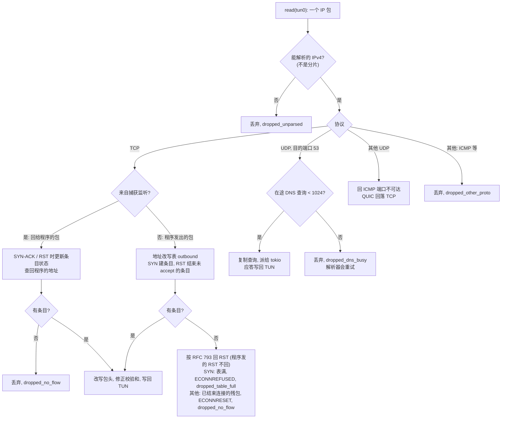
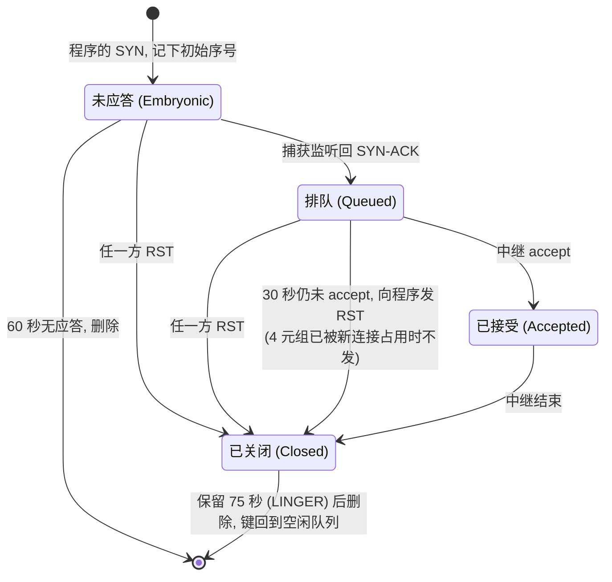
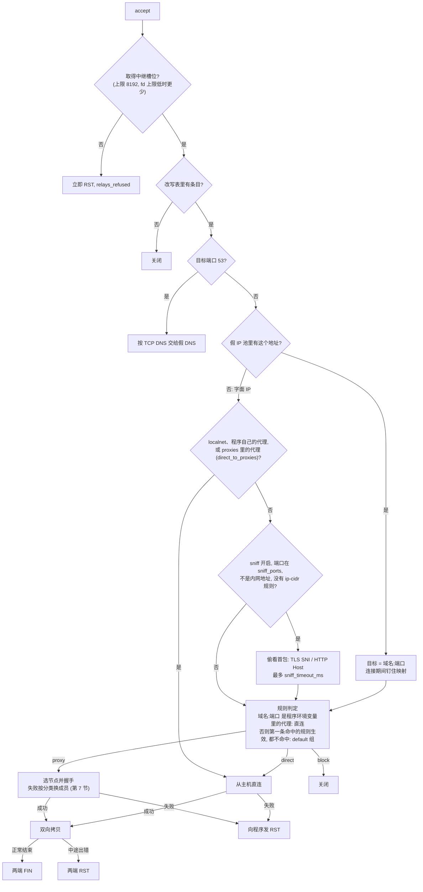

# proxytun 技术架构 · 3.3–3.6 流程细节

**简体中文** · [English](flow-details_en.md)

> [索引](../ARCHITECTURE.md) · [0 入门](primer.md) · [1–2 总览](overview.md) · [3.0–3.2 核心流程](flow.md) · **3.3–3.6 流程细节** · [4 模块](modules.md) · [5 运行模式与 sudo 助手](privilege.md) · [6 进程、信号与生命周期](lifecycle.md) · [7–8 负载均衡与运维](operations.md)

### 3.3 TUN 上的每个包

tun 线程阻塞地 `read` TUN,每读到一个包按下图处理。包的解析、地址改写和校验和修正都是对字节切片的纯函数(`packet.rs`);
转发的 TCP 数据包在读缓冲上原地改写，不分配内存、不复制;新连接的 SYN 只在改写表扩容时分配，回 RST、回 ICMP 和派发 DNS 查询时也分配。

- 每个 TCP 包都要拿一次地址改写表的锁。监听侧只有 SYN-ACK 和 RST 改变条目状态;程序侧 SYN 建条目(初始序号不同的 SYN 另分一个键)、
  RST 结束未 accept 的条目;普通数据包只查一次表。
- IPv6 包解析不了，丢弃;命名空间里本来就没有 IPv6 路由，字面 IPv6 连接立即"网络不可达"。

### 3.4 地址改写表

**键与容量。** 每条程序的 TCP 连接占一个"改写用的源地址:端口",源地址是 `fake_ip_range` 末尾 /24 的 `.2`–`.17`,端口 1024–65535,
共 16 × 64512 ≈ 103 万个。没用过的键由计数器依次给出(各地址轮流，平常的连接就会用到多个地址),释放的键进一个队列，先释放的先复用，
刚释放的最后才轮到;启动时不列出全部键。表满时程序的 SYN 立即收到 RST(ECONNREFUSED)。

**条目的状态。**

- **排队。** 监听侧回了 SYN-ACK,程序那端已经是 established,但中继还没 accept(fd 用尽、accept 队列积压)。条目不能删，
  否则程序永远收不到关闭;最多等 30 秒，到期向程序发 RST,序号取监听侧 SYN-ACK 的序号 + 1(established 状态下内核只接受序号
  正好等于期望值的 RST)。到期后条目进入已关闭并保留 75 秒：监听侧可能还持有那条连接。
- **同一 4 元组上的新连接。** 程序用同一个源端口重新连同一个目标时(绑定了固定端口的程序),初始序号不同的 SYN 是新连接，另分一个键;
  重传的 SYN(序号相同)用原来的键，但条目已关闭时任何 SYN 都是新连接、另分一个键。旧条目照旧由它自己的中继结束，在此之前它的键不会被复用。
- **已关闭。** 关闭后保留 75 秒(长于两端内核 60 秒的 TIME_WAIT),两端内核最后的 FIN/ACK 还能被改写;过后再收到程序的包，
  按 RFC 793 回 RST。
- **清扫。** 每种有时限的状态各有一条按到期时间排序的队列(未应答、排队、已关闭),清扫只看到期的项;队列里过时的项(条目已被替换或状态已变)
  靠"状态 + 进入该状态的时间"识别后跳过。清扫每秒一次，每次持锁最多处理 4096 个到期项，放锁 1 ms 再继续，
  不让 tun 线程因为等锁停顿太久(tun0 的发送队列只有 500 个包)。

持续新建连接的上限由键数和 LINGER 决定:1,032,192(16 × 64512)/ 75 秒 ≈ 每秒 1.38 万条。

### 3.5 中继：一条连接去哪里

捕获监听 accept 到连接后，按下图决定它的去向(`accept.rs` 的 accept 循环与 `relay::route`)。

- **出错时 RST。** 拨号失败时向程序发 RST;拷贝中途出错时两端都发 RST。下载被截断时，程序读到的是 ECONNRESET 而不是干净的 EOF,以 EOF 收尾的协议(HTTP/1.0 无长度、nc)
  不会把截断的数据当成完整的;拨号失败也不会表现为"连上后空回复";程序中止的上传，目标那边同样收到 RST。
- **出站连接开 TCP keepalive**(空闲 60 秒后探测，每 15 秒一次,4 次无应答即失败)。程序自己的 keepalive 由命名空间里的监听侧应答，
  到不了真实路径;有了它，路径中断的空闲长连接约 2 分钟后被发现，中继出错结束并向程序发 RST。
- **嗅探。** 只偷看，不消耗数据。私网、回环、链路本地、CGNAT 地址不嗅探(这类地址是有意连的);被某条 `ip-cidr` 规则覆盖的地址不嗅探
  (以 IP 规则为准);嗅到的名字命中 `sniff_skip_domains`(真 ECH 的公共名)时保留原 IP。
- **direct 的域名**由主机的系统解析器(`getaddrinfo`)解析，同时最多 32 个，超出时该连接立即失败。
- **主机端口转发**走另一套 accept 循环(`hostports.rs`):命名空间里与主机同地址的监听 socket 收到连接后，从主机连同一个地址，
  双向拷贝;共用中继槽位，出错时同样两端 RST。映射规则:`127.x.x.x:P` 对应自己,`0.0.0.0:P` 对应 `127.0.0.1:P`,
  `[::1]:P` 对应自己,`[::]:P` 对应 `127.0.0.1:P` 与 `[::1]:P`;53 端口不转发。

### 3.6 假 DNS

查询以两种方式到达：发往任意地址 53 端口的 UDP 包(由 tun 线程派给 tokio),以及发往 53 端口的 TCP 连接(由中继交给 `dns::serve_tcp`)。
两者用同一个应答函数:

| 查询 | 处理 |
|---|---|
| `A` | 分配假 IP,TTL 60 秒;`localhost`、`*.localhost` 答 `127.0.0.1`;根域 `.` 答空 |
| `AAAA`、`HTTPS`(65)、`SVCB`(64) | 本地答空(NOERROR),程序回落到 IPv4 假 IP;HTTPS/SVCB 的应答里有真实 IP 提示和 ECH 密钥，会让浏览器绕过假 IP |
| 其他(`MX`、`TXT`、`PTR`、`SRV` …)及非 `IN` 类 | 从主机转发给 `upstream_dns`,UDP 走 UDP、TCP 走 TCP,3 秒超时 |
| 假 IP 池回收不了 | `SERVFAIL`,不覆盖正在使用的映射 |

- **应答的源地址**就是程序问的那个地址(`8.8.8.8:53` 问的，就从 `8.8.8.8:53` 答),否则解析器会丢弃应答。
- **上限。** 经 TUN 到达的 UDP 查询同时最多 1024 个(在 tun 线程派任务之前计数，超出的直接丢弃;TCP 查询占中继槽位、不计入，且每次读写最多等 5 秒，发了长度就不说话、5 秒不来新查询或不读应答都会被断开);转发上游同时最多 256 个，超出的丢弃，
  由程序的解析器重试。只有 A 查询才构造转义后的域名，其他类型不付这份开销。
- **转发上游的校验。** 用已连接的 UDP socket(内核只放行来自上游地址的包),只接受事务 ID 和问题段都与查询一致的应答;不带问题段的错误应答只核对 ID(伪造它只能让查询失败，不能投毒)。
- **假 IP 池。** 地址按顺序分配;用完后回收最久未用、没有连接在用、距上次应答或使用超过 120 秒(TTL 的两倍)的映射。
  有连接在用的映射被钉住，移出回收队列(回收 O(log n))。映射最多 2^20(约 105 万)条。
- **命名空间的 `resolv.conf`** 只有 `nameserver 198.19.255.53`,保留主机的 `search` / `domain` / `sortlist` 与 `options`,
  但去掉 `ndots:N`:假 DNS 对任何名字都给地址，ndots ≥ 2 时解析器先试"名字 + 搜索域"就会被锁定在错误的名字上。
