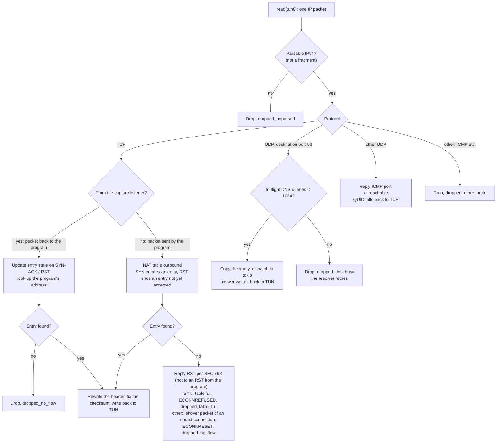
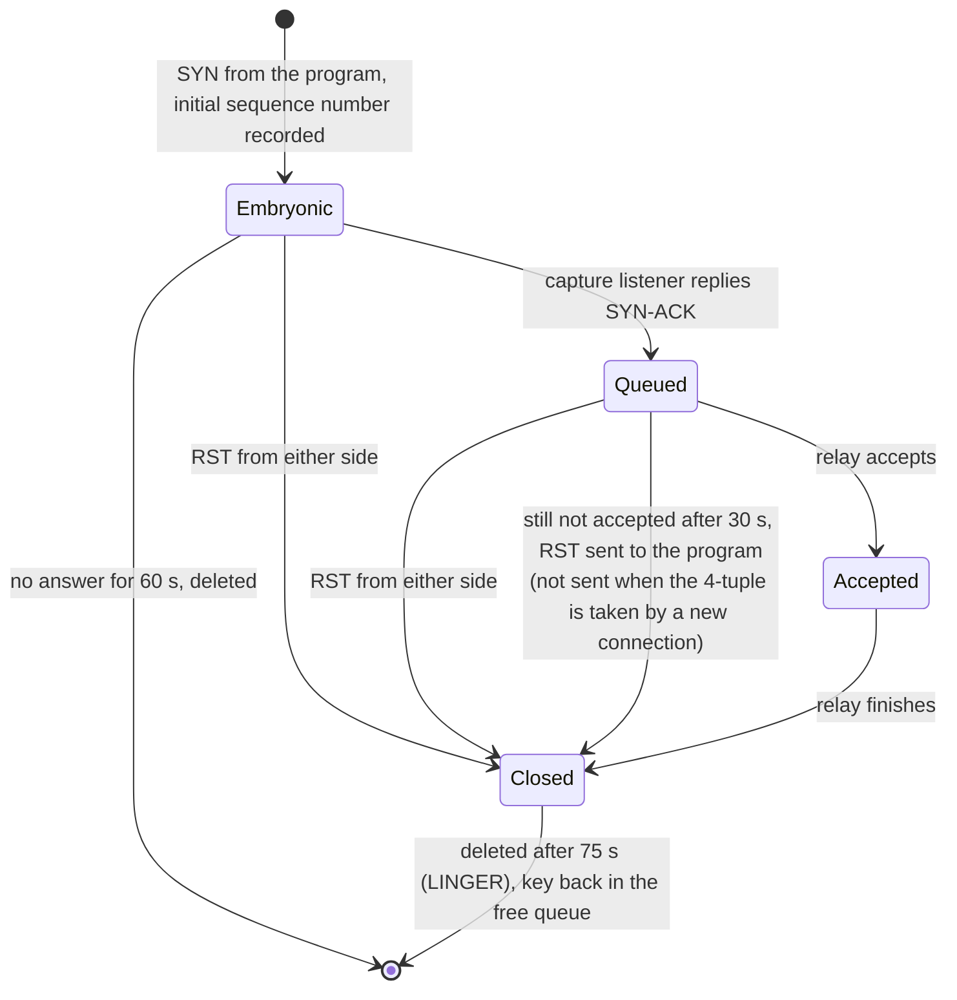
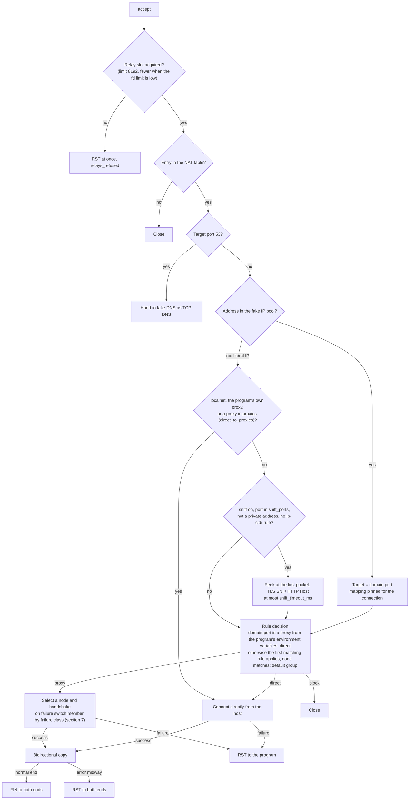

# proxytun architecture · 3.3–3.6 Flow details

[简体中文](flow-details.md) · **English**

> [Index](../ARCHITECTURE_en.md) · [0 Primer](primer_en.md) · [1–2 Overview](overview_en.md) · [3.0–3.2 Core flows](flow_en.md) · **3.3–3.6 Flow details** · [4 Modules](modules_en.md) · [5 Run modes and the sudo helper](privilege_en.md) · [6 Processes, signals and lifecycle](lifecycle_en.md) · [7–8 Load balancing and operations](operations_en.md)

### 3.3 Every packet on TUN

The tun thread does blocking `read`s on TUN and handles each packet it reads as shown below. Packet parsing, address rewriting and checksum fixing are all pure functions over byte slices (`packet.rs`);
forwarded TCP data packets are rewritten in place in the read buffer, with no allocation and no copy. A new connection's SYN allocates only when the NAT table grows; replying with RST, replying with ICMP and dispatching DNS queries also allocate.

- Every TCP packet takes the NAT table lock once. On the listener side only SYN-ACK and RST change entry state; on the program side a SYN creates an entry (a SYN with a different initial sequence number gets another key)
  and an RST ends an entry not yet accepted; ordinary data packets do a single table lookup.
- IPv6 packets cannot be parsed and are dropped; the namespace has no IPv6 route to begin with, so connections to literal IPv6 addresses fail at once with "network unreachable".

### 3.4 The NAT table

**Keys and capacity.** Each TCP connection of the program takes one "NAT source address:port"; the source addresses are `.2`–`.17` of the last /24 of `fake_ip_range`, the ports 1024–65535,
16 × 64512 ≈ 1.03 million in all. Unused keys are handed out in order by a counter (the addresses take turns, so ordinary connections already use several addresses); freed keys go into a queue, the first freed is reused first,
and a just-freed key comes last. Not all keys are listed at startup. When the table is full, the program's SYN gets an RST at once (ECONNREFUSED).

**Entry states.**

- **Queued.** The listener side has replied SYN-ACK and the program's end is already established, but the relay has not accepted yet (fds exhausted, accept queue backed up). The entry cannot be deleted,
  or the program would never see the connection close. It waits at most 30 seconds; on expiry an RST is sent to the program, with sequence number = the sequence number of the listener side's SYN-ACK + 1 (in the established state the kernel only accepts an RST whose sequence number
  exactly equals the expected value). After expiry the entry goes to Closed and is kept for 75 seconds: the listener side may still hold that connection.
- **A new connection on the same 4-tuple.** When the program reconnects to the same target from the same source port (a program bound to a fixed port), a SYN with a different initial sequence number is a new connection and gets another key;
  a retransmitted SYN (same sequence number) uses the original key, but once the entry is Closed any SYN is a new connection and gets another key. The old entry is still ended by its own relay as usual, and its key is not reused before then.
- **Closed.** Kept for 75 seconds after closing (longer than the 60-second TIME_WAIT of the kernels on both ends), so the final FIN/ACK of the kernels on both ends can still be rewritten. A packet from the program after that
  gets an RST per RFC 793.
- **Sweep.** Each timed state has its own queue ordered by expiry time (Embryonic, Queued, Closed), and the sweep looks only at expired items. Stale items in a queue (the entry has been replaced or its state has changed)
  are recognized by "state + time the state was entered" and skipped. The sweep runs once a second; each round handles at most 4096 expired items under the lock, then releases the lock for 1 ms before continuing,
  so the tun thread does not stall too long waiting for the lock (tun0's transmit queue holds only 500 packets).

The sustained rate of new connections is capped by the number of keys and LINGER: 1,032,192 (16 × 64512) / 75 s ≈ 13,800 per second.

### 3.5 The relay: where a connection goes

After the capture listener accepts a connection, where it goes is decided as shown below (the accept loop in `accept.rs` and `relay::route`).

- **RST on error.** When dialing fails, an RST is sent to the program; when copying fails midway, both ends get an RST. A truncated download reaches the program as ECONNRESET rather than a clean EOF, so EOF-terminated protocols (HTTP/1.0 without a length, nc)
  do not take truncated data as complete; a failed dial does not look like "connected, then an empty reply"; and for an upload the program aborts, the target likewise gets an RST.
- **Outbound connections enable TCP keepalive** (probing after 60 seconds idle, every 15 seconds, failing after 4 unanswered probes). The program's own keepalives are answered by the listener side in the namespace
  and never reach the real path; with this, an idle long-lived connection whose path broke is detected after about 2 minutes, and the relay ends with an error and sends an RST to the program.
- **Sniffing.** It only peeks and does not consume data. Private, loopback, link-local and CGNAT addresses are not sniffed (such addresses are connected to on purpose); addresses covered by an `ip-cidr` rule are not sniffed
  (the IP rule wins); when the sniffed name matches `sniff_skip_domains` (public names of real ECH), the original IP is kept.
- **Domains routed direct** are resolved by the host's system resolver (`getaddrinfo`), at most 32 at a time; beyond that the connection fails at once.
- **Host port forwarding** uses a separate accept loop (`hostports.rs`): when a listening socket in the namespace on the same address as on the host receives a connection, the same address is connected to from the host
  and data is copied both ways; it shares the relay slots, and on error likewise sends RST to both ends. Mapping: `127.x.x.x:P` maps to itself, `0.0.0.0:P` to `127.0.0.1:P`,
  `[::1]:P` to itself, `[::]:P` to `127.0.0.1:P` and `[::1]:P`; port 53 is not forwarded.

### 3.6 Fake DNS

Queries arrive in two ways: UDP packets to port 53 of any address (dispatched to tokio by the tun thread), and TCP connections to port 53 (handed to `dns::serve_tcp` by the relay).
Both use the same answering function:

| Query | Handling |
|---|---|
| `A` | Allocate a fake IP, TTL 60 seconds; `localhost` and `*.localhost` get `127.0.0.1`; the root `.` gets an empty answer |
| `AAAA`, `HTTPS` (65), `SVCB` (64) | Answered empty locally (NOERROR), so the program falls back to the IPv4 fake IP; HTTPS/SVCB answers carry real IP hints and ECH keys, which would make browsers bypass the fake IP |
| Other types (`MX`, `TXT`, `PTR`, `SRV` …) and non-`IN` classes | Forwarded from the host to `upstream_dns`, UDP over UDP and TCP over TCP, 3-second timeout |
| Fake IP pool cannot reclaim | `SERVFAIL`; mappings in use are not overwritten |

- **The answer's source address** is the address the program queried (queried at `8.8.8.8:53`, answered from `8.8.8.8:53`); otherwise the resolver would discard the answer.
- **Limits.** At most 1024 UDP queries arriving via TUN at a time (counted before the tun thread dispatches a task, excess ones dropped outright; TCP queries take a relay slot instead and are not counted, and each read or write waits at most 5 seconds: a client that sends a length and then goes silent, sends no new query for 5 seconds, or does not read its answers is disconnected); at most 256 forwarded upstream at a time, excess ones dropped
  and retried by the program's resolver. Only A queries build the escaped domain name; other types do not pay that cost.
- **Checks on upstream forwarding.** A connected UDP socket is used (the kernel only lets through packets from the upstream address), and only answers whose transaction ID and question section both match the query are accepted; an error answer without a question section is checked by ID only (forging one can only make the query fail, not poison it).
- **Fake IP pool.** Addresses are allocated in order; once they run out, the pool reclaims the least recently used mapping that no connection is using and that was last answered or used more than 120 seconds ago (twice the TTL).
  A mapping in use by a connection is pinned and taken out of the reclaim queue (reclaiming is O(log n)). At most 2^20 (about 1.05 million) mappings.
- **The namespace's `resolv.conf`** has `nameserver 198.19.255.53` as its only nameserver and keeps the host's `search` / `domain` / `sortlist` and `options`,
  but drops `ndots:N`: fake DNS gives an address for any name, so with ndots ≥ 2 the resolver would try "name + search domain" first and get locked onto the wrong name.
