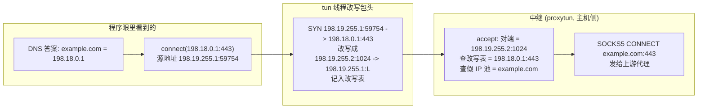
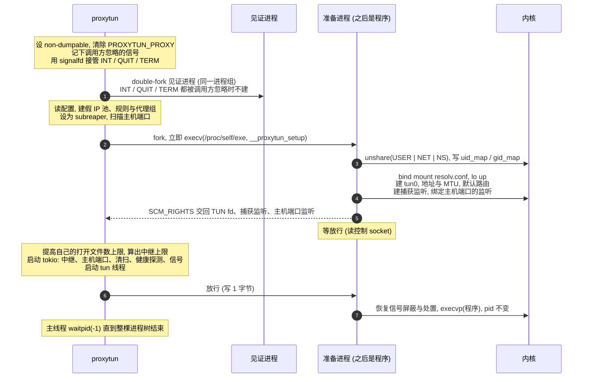
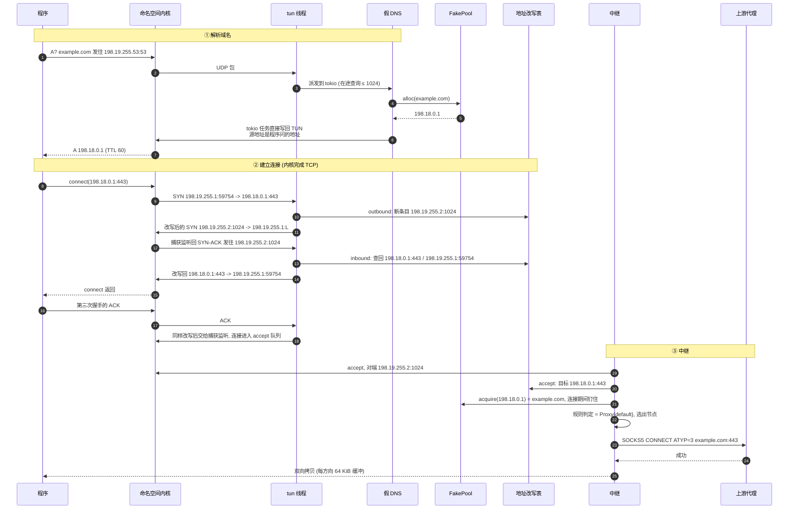

# proxytun 技术架构 · 3.0–3.2 核心流程

**简体中文** · [English](flow_en.md)

> [索引](../ARCHITECTURE.md) · [0 入门](primer.md) · [1–2 总览](overview.md) · **3.0–3.2 核心流程** · [3.3–3.6 流程细节](flow-details.md) · [4 模块](modules.md) · [5 运行模式与 sudo 助手](privilege.md) · [6 进程、信号与生命周期](lifecycle.md) · [7–8 负载均衡与运维](operations.md)

## 3. 核心流程

### 3.0 先分清几种地址

以默认的 `fake_ip_range = "198.18.0.0/15"` 为例:

| | 例子 | 是什么 | 谁看得到 |
|---|---|---|---|
| **假 IP** | `198.18.0.1` | 假 DNS 给程序的"域名答案",取自 `fake_ip_range` 去掉最后一个 /24 | 程序(它以为自己连的是这个地址) |
| **TUN 地址** | `198.19.255.1` | 命名空间里 `tun0` 的地址，也是程序连接的源地址和捕获监听的地址 | 程序、命名空间内核 |
| **假 DNS 地址** | `198.19.255.53` | 命名空间里 `/etc/resolv.conf` 指向它;发往任何地址 53 端口的查询也都由假 DNS 应答 | 程序的解析器 |
| **改写用的源地址** | `198.19.255.2`–`.17` : `1024`–`65535` | 地址改写表的键：每条程序的 TCP 连接分到一个"地址:端口" | 命名空间内核、proxytun |
| **捕获监听** | `198.19.255.1:<随机端口>` | 命名空间里 proxytun 的监听 socket,所有被改写的连接由它 accept | proxytun |

一句话：**假 IP 回答"这个域名是什么",改写用的源地址回答"这是哪一条连接",捕获监听回答"连接交给谁处理"。**



要点:

- **假 IP 从头到尾不会出现在网络上。** 程序发往假 IP 的包只到 TUN,被改写后交给命名空间里的监听 socket;发往假 IP 的 UDP 得到 ICMP 端口不可达。
- **改写用的源地址也不出命名空间**,它们只是命名空间内核里 TCP 连接的一端。16 个地址 × 64512 个端口，约 103 万条(见 3.4)。
- 程序看到的对端地址就是它连的地址(`curl -w '%{remote_ip}'` 打印 `198.18.0.1`),因为改写在包头层完成，程序的 socket 不知道这回事。

一次真实运行的日志节选(`proxytun -vv --proxy socks5://... curl https://www.baidu.com`,略去时间戳和与本节无关的行),对应上面的流程:

```
INFO  proxytun::app: namespace up tun=198.19.255.1 dns=198.19.255.53
DEBUG proxytun_core::net::dns: dns: A -> fake ip domain=www.baidu.com ip=198.18.0.1
                    ^ 程序的 A 查询到了假 DNS,分到假 IP
TRACE proxytun::capture: syn src=198.19.255.1:34830 dst=198.18.0.1:443 nat=198.19.255.2:1024
                    ^ 程序连假 IP,SYN 被改写到改写用的源地址 198.19.255.2:1024
TRACE conn{id=1}: proxytun::accept: accepted nat=198.19.255.2:1024 dst=198.18.0.1:443
INFO  conn{id=1 target=Domain("www.baidu.com", 443)}: proxytun_core::net::relay: routing decision=Proxy { group: "default" }
                    ^ 中继按对端地址查回目标，反查出域名，规则判定后交给代理。之后这条连接的每一行都带同一个 conn{…}
http=200 remote_ip=198.18.0.1
INFO  proxytun::signals: program exited exit=Code(0)
```

### 3.1 启动流程(user namespace 模式)



- **准备进程为什么要重新 exec。** proxytun 一启动就设为 non-dumpable(保护代理凭据),fork 出的子进程继承这一点，
  它的 `/proc/self/uid_map` 因此归 root、写不进去;而让子进程恢复 dumpable 又会暴露从父进程复制来的内存(含凭据)。
  重新 exec 后的新映像里没有凭据，也恢复为 dumpable。
- **为什么要等放行。** 程序 exec 之前,proxytun 必须已经在读 TUN、能 accept,否则程序的第一个包会无人处理。
- 没有非特权 user namespace 时，第 2–5 步(建准备进程、建并配置命名空间、交回 fd)改由 sudo 启动的特权助手完成，
  第 6 步的放行仍由 proxytun 发出，接收它并在第 7 步 exec 的是助手 fork 出、已经降权的程序一侧，流程见[第 5 节](privilege.md)。以 root 运行时不建 user namespace。

### 3.2 一次 HTTPS 访问的完整时序



DNS 侧的细节:A 查询本地回答假 IP;AAAA、HTTPS(65)、SVCB(64)回答空;`localhost` 回答 `127.0.0.1`;其余类型(MX/TXT/PTR...)
从主机转发给 `upstream_dns`。程序问的是哪个地址，应答就以哪个地址为源地址发回，解析器才会接受(见 3.6)。

连接结束时，中继关闭两端(出错时用 RST,见 3.5),改写表条目进入"已关闭"并保留 75 秒，让两端内核最后的 FIN/ACK 还能被改写(见 3.4)。
