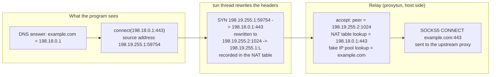
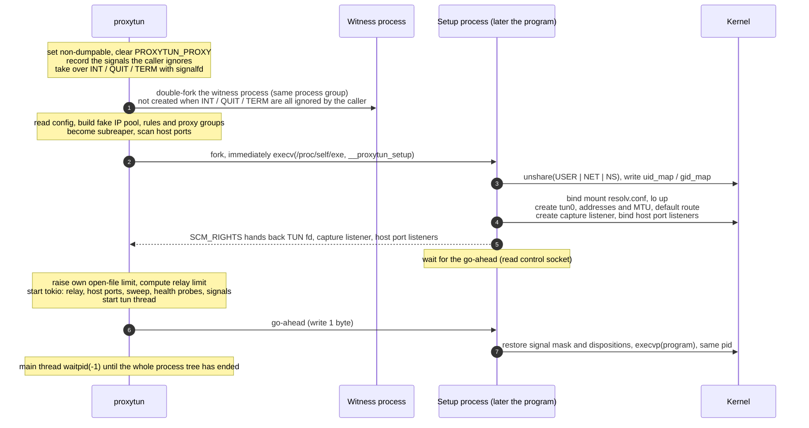
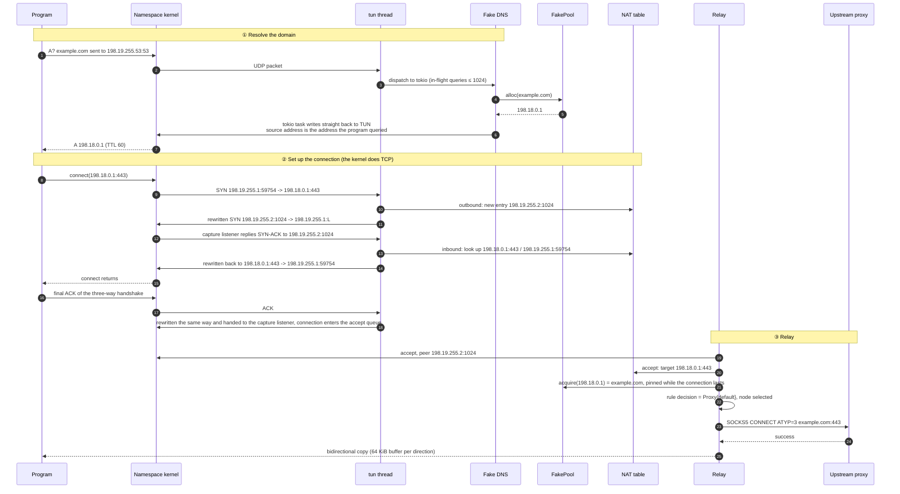

# proxytun architecture · 3.0–3.2 Core flows

[简体中文](flow.md) · **English**

> [Index](../ARCHITECTURE_en.md) · [0 Primer](primer_en.md) · [1–2 Overview](overview_en.md) · **3.0–3.2 Core flows** · [3.3–3.6 Flow details](flow-details_en.md) · [4 Modules](modules_en.md) · [5 Run modes and the sudo helper](privilege_en.md) · [6 Processes, signals and lifecycle](lifecycle_en.md) · [7–8 Load balancing and operations](operations_en.md)

## 3. Core flows

### 3.0 Telling the addresses apart

Taking the default `fake_ip_range = "198.18.0.0/15"` as an example:

| | Example | What it is | Who sees it |
|---|---|---|---|
| **Fake IP** | `198.18.0.1` | The "domain answer" fake DNS gives the program, taken from `fake_ip_range` minus its last /24 | The program (it believes it is connecting to this address) |
| **TUN address** | `198.19.255.1` | The address of `tun0` in the namespace; also the source address of the program's connections and the capture listener's address | The program, the namespace kernel |
| **Fake DNS address** | `198.19.255.53` | `/etc/resolv.conf` in the namespace points to it; queries to port 53 of any address are also answered by fake DNS | The program's resolver |
| **NAT source addresses** | `198.19.255.2`–`.17` : `1024`–`65535` | The keys of the NAT table: each TCP connection of the program gets one "address:port" | The namespace kernel, proxytun |
| **Capture listener** | `198.19.255.1:<random port>` | proxytun's listening socket in the namespace; every rewritten connection is accepted by it | proxytun |

In one sentence: **the fake IP answers "which domain is this", the NAT source address answers "which connection is this", the capture listener answers "who handles the connection".**



Key points:

- **A fake IP never appears on the network.** Packets the program sends to a fake IP only reach the TUN device and, rewritten, go to the listening socket in the namespace; UDP sent to a fake IP gets ICMP port unreachable.
- **The NAT source addresses never leave the namespace either**; they are only one end of TCP connections in the namespace kernel. 16 addresses × 64512 ports, about 1.03 million entries (see 3.4).
- The peer address the program sees is the address it connected to (`curl -w '%{remote_ip}'` prints `198.18.0.1`), because the rewriting happens at the packet header level and the program's socket is unaware of it.

Log excerpt from a real run (`proxytun -vv --proxy socks5://... curl https://www.baidu.com`, timestamps and lines unrelated to this section omitted), matching the flow above:

```
INFO  proxytun::app: namespace up tun=198.19.255.1 dns=198.19.255.53
DEBUG proxytun_core::net::dns: dns: A -> fake ip domain=www.baidu.com ip=198.18.0.1
                    ^ the program's A query reached fake DNS and got a fake IP
TRACE proxytun::capture: syn src=198.19.255.1:34830 dst=198.18.0.1:443 nat=198.19.255.2:1024
                    ^ the program connects to the fake IP; the SYN is rewritten to NAT source address 198.19.255.2:1024
TRACE conn{id=1}: proxytun::accept: accepted nat=198.19.255.2:1024 dst=198.18.0.1:443
INFO  conn{id=1 target=Domain("www.baidu.com", 443)}: proxytun_core::net::relay: routing decision=Proxy { group: "default" }
                    ^ the relay looks up the target by peer address, maps it back to the domain, and after the rule decision hands it to the proxy. Every later line of this connection carries the same conn{…}
http=200 remote_ip=198.18.0.1
INFO  proxytun::signals: program exited exit=Code(0)
```

### 3.1 Startup flow (user namespace mode)



- **Why the setup process re-execs.** proxytun makes itself non-dumpable right at startup (to protect proxy credentials), and a forked child inherits that,
  so its `/proc/self/uid_map` is owned by root and cannot be written; making the child dumpable again would instead expose the memory copied from the parent (credentials included).
  After the re-exec, the new image holds no credentials and is dumpable again.
- **Why wait for the go-ahead.** Before the program is exec'd, proxytun must already be reading TUN and able to accept; otherwise nobody handles the program's first packet.
- Without unprivileged user namespaces, steps 2–5 (creating the setup process, creating and configuring the namespaces, handing back the fds) are done instead by the privileged helper that sudo starts,
  proxytun still sends the go-ahead in step 6, and the one that receives it and execs in step 7 is the program side, which the helper forks and which has already dropped privileges; see [section 5](privilege_en.md) for the flow. When run as root, no user namespace is created.

### 3.2 The full sequence of one HTTPS request



DNS details: A queries are answered locally with a fake IP; AAAA, HTTPS (65) and SVCB (64) get an empty answer; `localhost` gets `127.0.0.1`; other types (MX/TXT/PTR...)
are forwarded from the host to `upstream_dns`. Whatever address the program queried, the answer is sent back with that address as its source; only then does the resolver accept it (see 3.6).

When the connection ends, the relay closes both ends (with RST on error, see 3.5), and the NAT table entry goes to "Closed" and is kept for 75 seconds, so the final FIN/ACK of the kernels on both ends can still be rewritten (see 3.4).
