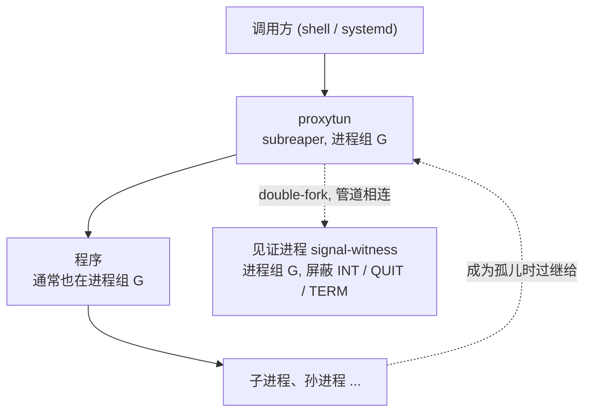
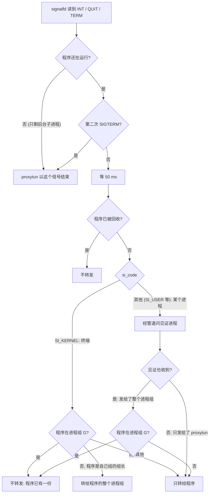

# proxytun 技术架构 · 6 进程、信号与生命周期

**简体中文** · [English](lifecycle_en.md)

> [索引](../ARCHITECTURE.md) · [0 入门](primer.md) · [1–2 总览](overview.md) · [3.0–3.2 核心流程](flow.md) · [3.3–3.6 流程细节](flow-details.md) · [4 模块](modules.md) · [5 运行模式与 sudo 助手](privilege.md) · **6 进程、信号与生命周期** · [7–8 负载均衡与运维](operations.md)

## 6. 进程、信号与生命周期

proxytun 的目标是"用起来和直接运行程序一样":退出码、Ctrl+C、`kill`、被忽略的信号都按程序自己的方式表现。
proxyhook 靠 ptrace 看见程序收到了什么;proxytun 没有 ptrace,用下面几样东西补上。

### 6.1 进程树

- **subreaper。** proxytun 设了 `PR_SET_CHILD_SUBREAPER`,程序的孤儿进程过继给它;主线程 `waitpid(-1)` 一直等到整棵进程树都结束
  (`ECHILD`),只要树里还有进程在运行,proxytun 就继续服务。
- **见证进程**double-fork 出来，不是 proxytun 的子进程，不影响"等整棵树";除了屏蔽着的这三个信号，其余信号一律忽略;管道断开即退出。它改名为 `signal-witness`
  (`comm` 与命令行都改),所以 `pkill proxytun`、`killall proxytun`、`pidof proxytun` 不会选中它。
  proxytun 是 pid 命名空间的 1 号进程(容器没加 `--init`)或预先被设为 subreaper 时，孤儿见证会被过继回来，所以程序被回收后
  proxytun 关闭见证的管道，让它退出、被回收。
- **sudo `use_pty` 下**程序离开了 sudo 的会话，在自己的会话和进程组里运行，不在 G 里(第 5 节)。

### 6.2 信号

| 信号 | 处理 |
|---|---|
| `SIGHUP` | 重新加载配置(第 8 节);配置有错则保留旧配置 |
| `SIGUSR1` | 打印统计(第 8 节) |
| `SIGINT` / `SIGQUIT` / `SIGTERM` | 不让 proxytun 退出，由程序自己处理;按下图决定要不要转发给程序 |
| 其他 | 不接管:SIGPIPE 被 Rust 运行时忽略，调用方忽略的信号保持忽略，其余为默认处置 |

INT / QUIT / TERM 在任何线程创建之前就被屏蔽，改由 `signalfd` 读取，这样能看到发送者的 `si_code`:终端发的是 `SI_KERNEL`,
进程用 `kill` 发的是 `SI_USER`。但 `kill <proxytun pid>` 与 `kill -- -<pgid>` / `kill %1` / systemd 逐进程发送，在 proxytun 看来都是 `SI_USER`,
分不出程序有没有也收到一份。见证进程解决这个问题：它与 proxytun 同在进程组 G、屏蔽这三个信号，发给整个进程组的信号会留在它的待处理集合里。

- **终端的信号转给整组。** 程序自成一组时(sudo `use_pty`),终端的 Ctrl+C 只到 proxytun 所在的前台组;proxytun 把它转给程序的整个进程组，
  管道里的其他进程也收到，与终端本来的效果一致。进程发的整组信号只转给程序本身:systemd 停服务时逐个给 cgroup 里的每个进程发，
  管道里的进程已经各有一份。
- **问见证进程**经管道一问一答(`q` → 8 字节的待处理信号掩码),不读 `/proc`:`hidepid` 下 non-dumpable 的见证在 `/proc` 里看不到。
  提问前先清掉管道里迟到的旧应答;提问放在阻塞线程池里，最多等 1 秒。每次判断后清空见证的待处理信号。
- **已知的、分不出来的情况**:程序不在 G 里时，逐进程发送(systemd、`kill -1`、`pkill -u`)会让它收到两份;50 ms 内连发两次 SIGTERM 时，
  第二次让 proxytun 立即退出，程序可能一份也没收到;50 ms 内两次同类整组信号会多转发一次(见证只记"有没有",不记次数);
  启动最初几毫秒(屏蔽这三个信号之前)收到的按默认处置直接结束 proxytun;之后到程序 fork 出来之前
  (读配置、扫描主机端口)收到的整组信号(终端的 Ctrl+C,或见证启动后由进程发给整组的)不转发：程序那时还不存在，却被当成已经收到。

### 6.3 退出

- **程序正常退出**:proxytun 等整棵进程树结束后，以程序的退出码退出。
- **程序被信号杀死**:proxytun 关掉 core、恢复默认处置、解除屏蔽后对自己发同一个信号，调用方看到的同样是"被信号杀死"
  (`timeout`、sudo、strace 的做法)。bash 循环里按 Ctrl+C 会停下(bash 只在子进程被信号杀死时停止循环),
  systemd 停止服务时不算失败。proxytun 自己因信号退出(程序已退出后的 Ctrl+C、收到第二个 SIGTERM,不论间隔多久)同样以该信号结束。
- **proxytun 被 `kill -9` 或崩溃**:不杀程序。TUN 随 fd 关闭消失，程序只剩回环，等于断网，不会绕过代理直连。
- 主程序被回收后不再按 pid 匹配退出码(pid 可能被树里后来的进程复用)。

### 6.4 被忽略的信号与 SIGPIPE

调用方忽略的信号(`nohup` 忽略 SIGHUP,脚本里的 `cmd &` 忽略 SIGINT / SIGQUIT)在程序里保持忽略：处置跨 exec 保留，
proxytun 自己的处理器在 fork 之后才装，准备进程 exec 程序前只改回它自己动过的两处：清空信号屏蔽(调用方原有的屏蔽不保留)、把 SIGPIPE 设回调用方的处置。
INT / QUIT / TERM 若被调用方忽略,proxytun 也不接管它们。

SIGPIPE 例外:Rust 运行时在 `main` 之前就把它设为忽略，所以 proxytun 用 ELF 构造函数(`.init_array`,在运行时之前执行)记下进程映像启动时的处置。
userns 模式下准备进程 re-exec 前先设回调用方的处置，它自己的构造函数就能读到;sudo 模式下随请求传给助手。
程序因此得到调用方的设置：调用方没有 `trap '' PIPE` 时，写已关闭的管道照常被 SIGPIPE 杀死，不报 "Broken pipe"。

调用方忽略 SIGCHLD 时(也跨 exec 保留),proxytun 在程序启动后、放行前把自己的 SIGCHLD 恢复为默认，否则内核自动回收子进程，
程序的退出码丢失;程序已经 fork,保留调用方的设置。

本节的行为在 userns 模式下有端到端测试覆盖,root 模式走同一条路径;sudo 模式下程序经 sudo 和特权助手拉起，
除 SIGPIPE(随请求传递)外，其他信号的处置取决于 sudo 怎样恢复，未单独验证。

### 6.5 日志的写入

日志写 stderr 时从不阻塞、从不失败：读端停住(Ctrl+S、没人读的管道)时，写日志的线程(中继、DNS、信号处理)不能跟着卡住;
读端关掉(`2>&1 | head`、终端断开)时也不能因写失败而 panic。

- 关掉 tracing 的 `log_internal_errors`(它会用 `eprintln!` 报告写失败，而 `eprintln!` 本身失败就 panic)。
- stderr 是管道或终端时，另开一个非阻塞的打开文件描述(`/proc/self/fd/2`),不改程序共用的那一个;另开被拒时(别人的终端或管道)
  每次写之前先 poll,确认还能写才写，每次最多 4 KiB。
- stderr 是 socket(journald)时用 `send(MSG_DONTWAIT)`;是普通文件时照常写。
- 写不下的日志行直接丢弃。要完整的日志用 `--log-file`(追加写、权限 600、不跟随符号链接、已存在的文件必须是自己的普通文件)。
