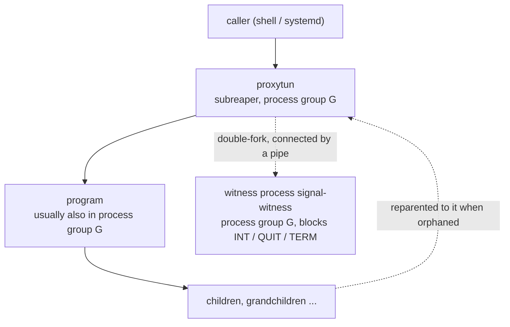
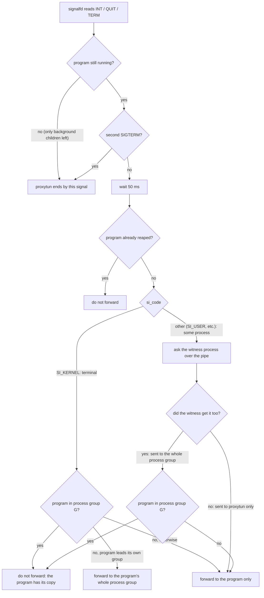

# proxytun architecture · 6 Processes, signals and lifecycle

[简体中文](lifecycle.md) · **English**

> [Index](../ARCHITECTURE_en.md) · [0 Primer](primer_en.md) · [1–2 Overview](overview_en.md) · [3.0–3.2 Core flows](flow_en.md) · [3.3–3.6 Flow details](flow-details_en.md) · [4 Modules](modules_en.md) · [5 Run modes and the sudo helper](privilege_en.md) · **6 Processes, signals and lifecycle** · [7–8 Load balancing and operations](operations_en.md)

## 6. Processes, signals and lifecycle

proxytun aims to "behave like running the program directly": exit status, Ctrl+C, `kill` and ignored signals all behave the way the program itself does.
proxyhook relies on ptrace to see what the program receives; proxytun has no ptrace and makes up for it with the pieces below.

### 6.1 Process tree

- **subreaper.** proxytun sets `PR_SET_CHILD_SUBREAPER`, so the program's orphaned processes are reparented to it; the main thread's `waitpid(-1)` waits until the whole process tree has ended
  (`ECHILD`). As long as any process in the tree is still running, proxytun keeps serving.
- **The witness process** is double-forked, so it is not a child of proxytun and does not affect "waiting for the whole tree"; apart from the three signals it blocks, it ignores every signal; it exits as soon as the pipe breaks. It is renamed `signal-witness`
  (both `comm` and the command line), so `pkill proxytun`, `killall proxytun` and `pidof proxytun` do not pick it.
  When proxytun is pid 1 of its pid namespace (a container without `--init`) or was made a subreaper beforehand, the orphaned witness is reparented back to it, so after the program is reaped
  proxytun closes the witness's pipe so that it exits and is reaped.
- **Under sudo `use_pty`** the program has left sudo's session and runs in its own session and process group, not in G (section 5).

### 6.2 Signals

| Signal | Handling |
|---|---|
| `SIGHUP` | Reloads the config (section 8); if the config has errors the old one is kept |
| `SIGUSR1` | Prints stats (section 8) |
| `SIGINT` / `SIGQUIT` / `SIGTERM` | Do not make proxytun exit; the program handles them itself; whether to forward them to the program is decided as in the diagram below |
| Others | Not taken over: SIGPIPE is ignored by the Rust runtime, signals the caller ignores stay ignored, the rest keep the default disposition |

INT / QUIT / TERM are blocked before any thread is created and read from a `signalfd` instead, which shows the sender's `si_code`: the terminal's is `SI_KERNEL`,
a process's `kill` is `SI_USER`. But `kill <proxytun pid>` and `kill -- -<pgid>` / `kill %1` / systemd sending to each process all look like `SI_USER` to proxytun,
which cannot tell whether the program got a copy as well. The witness process solves this: it is in process group G with proxytun and blocks these three signals, so a signal sent to the whole process group stays in its pending set.

- **Terminal signals go to the whole group.** When the program is in a group of its own (sudo `use_pty`), the terminal's Ctrl+C reaches only the foreground group proxytun is in; proxytun forwards it to the program's whole process group,
  so the other processes in the pipeline get it too, the same effect the terminal would have had. A group-wide signal sent by a process is forwarded to the program itself only: when systemd stops a service it sends to every process in the cgroup one by one,
  so the processes in the pipeline each have a copy already.
- **Asking the witness process** is one question and one answer over the pipe (`q` → an 8-byte pending-signal mask), without reading `/proc`: under `hidepid` a non-dumpable witness is not visible in `/proc`.
  Before asking, stale answers that arrived late are drained from the pipe; the question runs in the blocking thread pool and waits at most 1 second. After each decision the witness's pending signals are cleared.
- **Known cases that cannot be told apart**: when the program is not in G, sending to each process (systemd, `kill -1`, `pkill -u`) gives it two copies; with two SIGTERMs within 50 ms,
  the second makes proxytun exit at once and the program may have received none; two group-wide signals of the same kind within 50 ms are forwarded one extra time (the witness records only "whether", not how many);
  a signal received in the first few milliseconds of startup (before these three signals are blocked) ends proxytun by its default disposition; a group-wide signal (the terminal's Ctrl+C, or one a process sent to the whole group after the witness started) received after that and before the program is forked
  (reading the config, scanning host ports) is not forwarded: the program does not exist yet, but is treated as having received it.

### 6.3 Exit

- **The program exits normally**: once the whole process tree has ended, proxytun exits with the program's exit status.
- **The program is killed by a signal**: proxytun disables core dumps, restores the default disposition, unblocks the signal and sends the same signal to itself, so the caller also sees "killed by a signal"
  (what `timeout`, sudo and strace do). Ctrl+C in a bash loop stops the loop (bash stops a loop only when the child was killed by a signal),
  and systemd stopping the service does not count as a failure. When proxytun itself exits because of a signal (Ctrl+C after the program has exited, a second SIGTERM received, however long after the first), it likewise ends by that signal.
- **proxytun is killed with `kill -9` or crashes**: the program is not killed. The TUN disappears as its fd closes, leaving the program only loopback, i.e. no network; it does not bypass the proxy and connect directly.
- Once the main program has been reaped, exit statuses are no longer matched by pid (the pid may be reused by a later process in the tree).

### 6.4 Ignored signals and SIGPIPE

Signals the caller ignores (`nohup` ignores SIGHUP, `cmd &` in a script ignores SIGINT / SIGQUIT) stay ignored in the program: dispositions survive exec,
proxytun installs its own handlers only after the fork, and before exec'ing the program the setup process changes back only the two things it touched itself: it clears the signal mask (the caller's original mask is not kept) and sets SIGPIPE back to the caller's disposition.
If the caller ignores INT / QUIT / TERM, proxytun does not take them over either.

SIGPIPE is the exception: the Rust runtime sets it to ignored before `main`, so proxytun records the disposition at process-image start with an ELF constructor (`.init_array`, run before the runtime).
In userns mode the setup process sets the caller's disposition back before it re-execs, so its own constructor can read it; in sudo mode it goes to the helper with the request.
The program thus gets the caller's setting: when the caller has no `trap '' PIPE`, writing to a closed pipe kills it with SIGPIPE as usual, without a "Broken pipe" message.

When the caller ignores SIGCHLD (this too survives exec), proxytun restores its own SIGCHLD to the default after the program has started and before the go-ahead; otherwise the kernel would reap children automatically
and the program's exit status would be lost. The program has already been forked, so it keeps the caller's setting.

The behavior in this section is covered by end-to-end tests in userns mode; root mode takes the same path. In sudo mode the program is started through sudo and the privileged helper,
and apart from SIGPIPE (passed with the request) the other signal dispositions depend on how sudo restores them; this is not verified separately.

### 6.5 Writing logs

Logging to stderr never blocks and never fails: when the reader stalls (Ctrl+S, a pipe nobody reads), the threads that write logs (relay, DNS, signal handling) must not stall with it;
when the reader goes away (`2>&1 | head`, a disconnected terminal) they must not panic on a failed write either.

- tracing's `log_internal_errors` is turned off (it reports write failures with `eprintln!`, and `eprintln!` itself panics when it fails).
- When stderr is a pipe or a terminal, a separate non-blocking open file description is opened (`/proc/self/fd/2`) instead of changing the one the program shares; when that open is refused (someone else's terminal or pipe),
  each write is preceded by a poll and happens only if writing is still possible, at most 4 KiB at a time.
- When stderr is a socket (journald), `send(MSG_DONTWAIT)` is used; when it is a regular file, writes are as usual.
- Log lines that cannot be written are dropped. For complete logs use `--log-file` (appends, mode 600, does not follow symlinks, an existing file must be a regular file you own).
