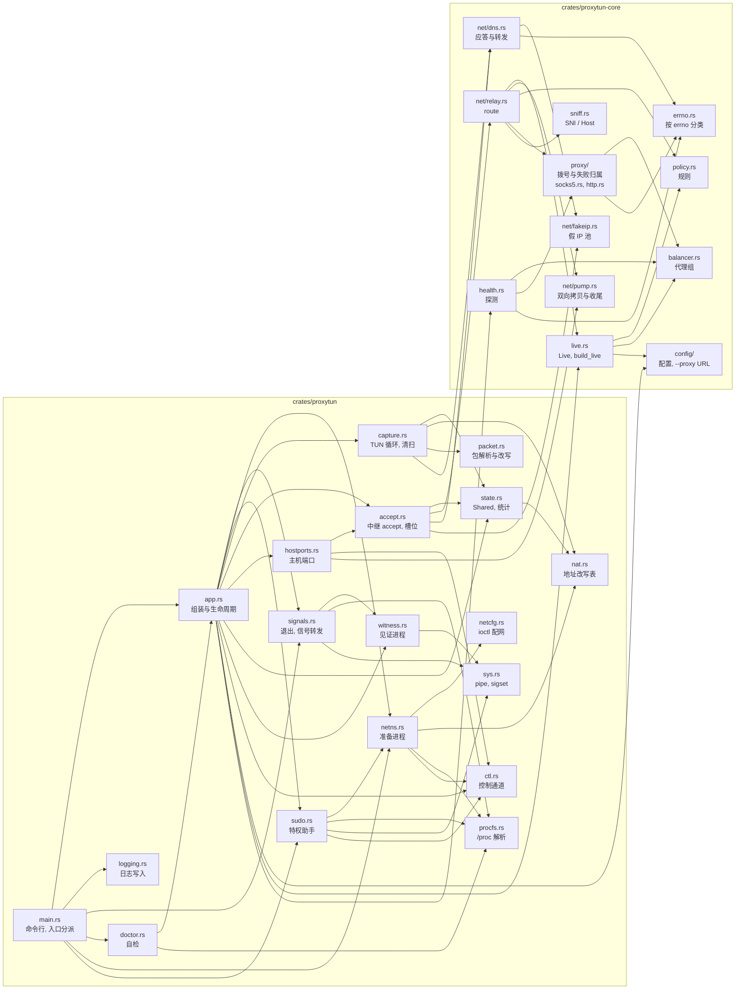

# proxytun 技术架构 · 4 模块

> [索引](../ARCHITECTURE.md) · [0 入门](primer.md) · [1–2 总览](overview.md) · [3.0–3.2 核心流程](flow.md) · [3.3–3.6 流程细节](flow-details.md) · **4 模块** · [5 运行模式与 sudo 助手](privilege.md) · [6 进程、信号与生命周期](lifecycle.md) · [7–8 负载均衡与运维](operations.md)

## 4. 模块

### 4.1 两个 crate

| crate | 职责 | 与捕获方式的关系 |
|---|---|---|
| `crates/proxytun-core` | 代理侧：配置、规则、负载均衡与健康检查、SOCKS5 / HTTP 握手、假 IP 池、假 DNS 应答与转发、嗅探、中继 | 不知道流量是怎么捕获的;来自 proxyhook,去掉了 ptrace 相关的部分 |
| `crates/proxytun` | 捕获侧与程序：命名空间、TUN、地址改写、sudo 助手、见证进程、主机端口转发、自检、命令行 | 把捕获到的连接和 DNS 查询交给 core |

### 4.2 `crates/proxytun` 各模块

| 文件 | 职责 |
|---|---|
| `main.rs` | 命令行解析(程序名之后的参数原样交给程序)、拒绝经 sudo / setuid 以 root 运行、分派内部入口、`--doctor` 与正常运行 |
| `logging.rs` | 日志初始化：stderr 从不阻塞、从不失败的写入器(见 [6.5](lifecycle.md#65-日志的写入)),或追加写 `--log-file` |
| `app.rs` | 把各部分接起来：读配置与 `--proxy` 覆盖、建命名空间(userns,不能用时 sudo)、提高 fd 上限并算出中继上限、启动 tokio 上的服务(中继、主机端口、清扫、健康探测)与 tun 线程、放行程序;SIGHUP 热加载(并换掉健康探测)、SIGUSR1 统计 |
| `signals.rs` | 退出与 INT/QUIT/TERM:在任何线程之前屏蔽、改由 signalfd 读取，判断要不要转发给程序(问见证进程),等整棵进程树，按程序的方式退出(第 6 节) |
| `netns.rs` | proxytun 自己的地址(`Addrs`:假 IP 范围最后一个 /24,假 IP 池不分配);准备进程：fork 后重新 exec 自己，建 user / 网络 / 挂载命名空间，写 `resolv.conf` 并 bind mount,建 TUN 与捕获监听，经 socketpair 交回 fd,等放行后 exec 程序;exec 前恢复信号屏蔽和调用方的 SIGPIPE 处置 |
| `ctl.rs` | proxytun 与建命名空间的一方(准备进程;sudo 模式下是特权助手及其 fork 出的程序一侧)之间的控制通道：一个 SOCK_SEQPACKET socket 上带 fd(SCM_RIGHTS)的消息、`OK` / `ERR` 应答(`recv_setup`,读到失败应答时回收准备进程)、放行(`Child::go` / `wait_go`)、列表编码 |
| `netcfg.rs` | 用 ioctl 配网(不依赖 `ip` 命令和 netlink):建 TUN、地址与 MTU、链路 up、默认路由、绑定监听 |
| `sudo.rs` | sudo 模式：proxytun 一侧(私有目录里的 unix socket、调 sudo、发请求)与 root 助手一侧(校验调用者、建命名空间、让降权后的程序接收请求和 fd) |
| `capture.rs` | tun 线程的包循环(TCP 按方向改写：捕获监听回给程序的包、程序发出的包;UDP 53 派给假 DNS、其他 UDP 回 ICMP),改写表清扫 |
| `accept.rs` | 捕获监听 accept 之后：accept 循环与中继槽位(主机端口转发共用,超出上限立即 RST)、按改写表找回目标、假 IP 反查并钉住、TCP DNS 分派、交给 `relay::route`;中继中的连接(捕获的与主机端口的)各有一个守卫 `Relaying`,无论怎样结束都退出 `active` 计数、关闭改写表条目 |
| `state.rs` | 共享状态 `Shared`(见 [4.4](#44-共享状态与线程))、同时中继的上限 `MAX_RELAYS`、统计计数(`Stats`),SIGUSR1 时打印总数与速率 |
| `nat.rs` | 地址改写表：键的分配与回收、条目状态机、到期队列、分批清扫 |
| `packet.rs` | IPv4 / TCP / UDP 头的解析、地址改写与增量校验和，构造 RST、UDP 应答、ICMP 端口不可达 |
| `hostports.rs` | 启动时扫描主机上回环与通配地址的监听(`/proc/net/tcp`、`tcp6`),算出命名空间里要开的地址(监听由准备进程或特权助手绑定);accept 后把连接转到主机 |
| `witness.rs` | 见证进程:double-fork、改名为 `signal-witness`、屏蔽 INT/QUIT/TERM,经管道回答"有哪些待处理信号" |
| `doctor.rs` | `--doctor`:配置读不了或有错时记一项 FAIL,仍用默认设置检查主机;按真实路径建一次命名空间跑 `true`,报告模式、TUN、Yama、主机端口、每个代理 |
| `procfs.rs` | 解析 `/proc/<pid>/stat` 里的父进程、进程组、会话(从最后一个 `)` 往后数，程序名含空格和括号也不错位)与内核版本号;信号转发、sudo 助手(校验调用者、加入进程组)、挂载传播方式、自检都用它 |
| `sys.rs` | 几个模块共用的 libc 薄封装:close-on-exec 的管道(sudo 助手、见证进程)、由信号列表构造 `sigset_t`(signals、见证进程) |

### 4.3 `crates/proxytun-core` 各模块

| 文件 | 职责 |
|---|---|
| `config/` | `mod.rs`:配置文件的解析、规范化与校验(按代理、代理组、各项取值、规则分开校验),运行时用到的查询(上游 DNS 地址、文件权限提醒);`proxy_url.rs`:`--proxy` / `PROXYTUN_PROXY` 的 URL 解析与覆盖，消息里隐去凭据 |
| `policy.rs` | 程序环境变量里的代理地址;直连判定(`localnet`、程序自己的代理)与规则匹配，纯逻辑 |
| `balancer.rs` | 代理节点(健康、活跃连接数、延迟)与代理组，六种选择策略，只读原子量、不加锁 |
| `live.rs` | `Live`:一代配置的规则、代理组与嗅探设置，中继每条连接读一次,SIGHUP 时整体替换;`Live::new` 只由配置和给定的环境变量构造,`build_live` 读本进程的环境变量后调用它 |
| `health.rs` | 并发的主动健康探测:TCP 连接，再做代理自己那部分握手(`proxy::greet`:SOCKS5 问候，含认证;HTTP 没有),不涉及协议细节 |
| `proxy/` | `socks5.rs`(ATYP=3 域名、用户名密码认证)与 `http.rs`(CONNECT,逐字节读应答头)两种握手;`mod.rs`:连一个节点(按协议穷尽 `match`,连接、问候、请求各自计时)、健康探测的问候、组内换成员重试，失败由 `Blame` 归类(目标的问题 / 说不清或代理自己的规则 / 本机端口耗尽 / 本机资源不足 / 代理的问题，见 [7.2](operations.md#72-握手与失败分类)) |
| `sniff.rs` | 从首包里取 TLS SNI 或 HTTP Host,纯函数 |
| `net/fakeip.rs` | 假 IP 池:应答的 TTL(60 秒)、LRU、连接期间钉住、120 秒内不回收、最多 100 万条 |
| `net/dns.rs` | 假 DNS 应答(A / AAAA / HTTPS / SVCB / localhost)、向上游转发(UDP、TCP)与应答校验、转发并发上限(256) |
| `net/relay.rs` | `Pending`(捕获侧交来的连接：目标与钉住假 IP 的守卫);`route`:嗅探、规则、拨号(代理组或直连)、出站 keepalive,再交给 `pump::finish`;direct 规则的域名解析上限 |
| `net/pump.rs` | `finish`(`route` 与主机端口转发共用的收尾):双向拷贝并计数(`Traffic`)、出错时两端 RST、结束汇总 |
| `errno.rs` | 按错误链里的 errno 判断失败原因：本机资源不足(fd、缓冲区、内存、本地端口)不算代理或上游的问题;拨号、健康探测、DNS 转发都用它 |
| `throttle.rs` | 会按包、按查询、按 accept 频率重复的日志，限速为每 10 秒一条 |
| `types.rs` | 捕获侧与中继侧之间传递的类型(目标、规则判定结果) |

### 4.4 共享状态与线程

proxytun 进程里各部分通过一个 `Shared` 结构(`state.rs`)共享状态，主要字段如下(另有监听地址、上游 DNS 地址、日志限速等):

| 状态 | 类型 | 谁在用 |
|---|---|---|
| 地址改写表 `nat` | `Mutex<Nat>` | tun 线程(每个 TCP 包)、中继 accept、清扫 |
| 假 IP 池 `pool` | 内部 `Mutex` | 假 DNS(分配)、中继(反查并钉住) |
| 规则与代理组 `live` | `RwLock<Arc<Live>>` | 中继每条连接读一次;SIGHUP 时整体替换 |
| 统计 `stats`、`dns`、`traffic` | 原子计数(`dns` 里还有转发上游的并发信号量) | 各处累加,SIGUSR1 读出 |
| 中继槽位 `relay_slots` | `Arc<Semaphore>` | 中继与主机端口转发 accept 时各取一个 |

| 线程 / 进程 | 做什么 |
|---|---|
| 主线程 | 启动完成后只做 `waitpid(-1)`,等程序的整棵进程树结束 |
| `tun` 线程 | 阻塞读 TUN,写回转发的 TCP 包;数据面的瓶颈，见 [PERFORMANCE.md](../PERFORMANCE.md)。DNS 应答和清扫发出的 RST 由 tokio 线程直接写 TUN |
| tokio 工作线程 | 中继、主机端口转发、DNS、健康探测、清扫、信号 |
| tokio 阻塞线程池 | direct 规则对域名的 `getaddrinfo`、问见证进程;最多 64 个线程(都占用户的进程数额度) |
| 见证进程 | 独立的小进程，与 proxytun 同一进程组(第 6 节) |
