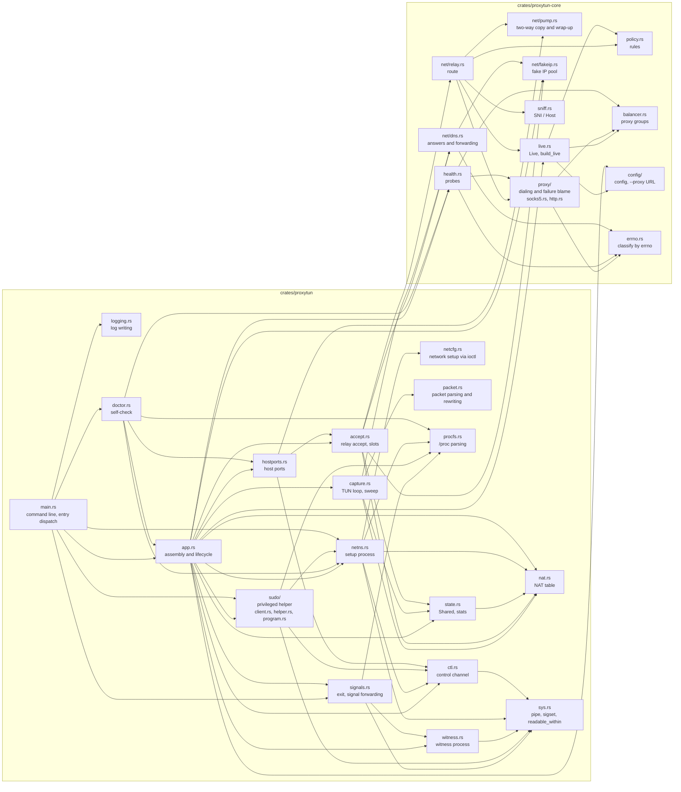

# proxytun architecture · 4 Modules

[简体中文](modules.md) · **English**

> [Index](../ARCHITECTURE_en.md) · [0 Primer](primer_en.md) · [1–2 Overview](overview_en.md) · [3.0–3.2 Core flows](flow_en.md) · [3.3–3.6 Flow details](flow-details_en.md) · **4 Modules** · [5 Run modes and the sudo helper](privilege_en.md) · [6 Processes, signals and lifecycle](lifecycle_en.md) · [7–8 Load balancing and operations](operations_en.md)

## 4. Modules

### 4.1 Two crates

| crate | Responsibility | Relation to how traffic is captured |
|---|---|---|
| `crates/proxytun-core` | Proxy side: config, rules, load balancing and health checks, SOCKS5 / HTTP handshakes, fake IP pool, fake DNS answers and forwarding, sniffing, relay | Does not know how traffic is captured; comes from proxyhook, with the ptrace-related parts removed |
| `crates/proxytun` | Capture side and the binary: namespaces, TUN, address rewriting, sudo helper, witness process, host port forwarding, self-check, command line | Hands captured connections and DNS queries to core |

### 4.2 `crates/proxytun` modules

| File | Responsibility |
|---|---|
| `main.rs` | Command-line parsing (arguments after the program name go to the program unchanged), refusing to run as root through sudo / setuid, dispatching internal entry points, `--doctor` and normal runs |
| `logging.rs` | Log setup: a stderr writer that never blocks and never fails (see [6.5](lifecycle_en.md#65-writing-logs)), or appending to `--log-file` |
| `app.rs` | Wires the parts together: reads the config and the `--proxy` override, builds the namespace (userns; sudo when that cannot be used), raises the fd limit and works out the relay cap, starts the services on tokio (relay, host ports, sweep, health probes) and the tun thread, gives the program the go-ahead; SIGHUP hot reload (also replaces the health probes), SIGUSR1 stats |
| `signals.rs` | Exit and INT/QUIT/TERM: blocked before any thread exists and read from a signalfd instead; decides whether to forward them to the program (asks the witness process); waits for the whole process tree; exits the way the program did (section 6) |
| `netns.rs` | proxytun's own addresses (`Addrs`: the last /24 of the fake IP range, never handed out by the fake IP pool); the setup process: re-execs itself after fork, creates the user / network / mount namespaces, writes `resolv.conf` and bind-mounts it, creates the TUN and the capture listener, hands the fds back over a socketpair, waits for the go-ahead, then execs the program; when setup fails, kills and reaps the setup process (if it has already answered, it is waiting for the go-ahead and will not exit by itself); restores the signal mask and the caller's SIGPIPE disposition before exec |
| `ctl.rs` | The control channel between proxytun and the side that builds the namespace (the setup process; in sudo mode the privileged helper and the program side it forks): messages carrying fds (SCM_RIGHTS) on one SOCK_SEQPACKET socket, `OK` / `ERR` replies (`recv_setup`, waits at most 60 seconds), the go-ahead (`Child::go` / `wait_go`), list encoding |
| `netcfg.rs` | Network setup with ioctl (no dependency on the `ip` command or netlink): creates the TUN, address and MTU, link up, default route, binds listeners |
| `sudo/` | sudo mode, one file per process role (see [5.2](privilege_en.md#52-the-sudo-mode-flow)): `mod.rs`: request encoding and decoding, the program's identity `Identity`, constants and socket settings shared by the parties, refusing to run as root through sudo / setuid (`root_refusal`); `client.rs`: proxytun's side, run as the user (unix socket in a private directory, invoking sudo, sending the request and fds); `helper.rs`: the root helper (checks the caller, security context and resource limits, builds the empty namespaces and forks the program side, rechecks the request, configures the namespaces and hands them back); `program.rs`: the forked program side (drops from root to the user, then receives the request and fds and forwards the request to the helper, execs the program after the go-ahead) |
| `capture.rs` | The tun thread's packet loop (TCP rewritten by direction: packets from the capture listener back to the program, packets the program sends; UDP 53 dispatched to fake DNS, other UDP answered with ICMP), NAT table sweep |
| `accept.rs` | After the capture listener's accept: the accept loop and relay slots (shared with host port forwarding; over the cap, immediate RST), recovering the target from the NAT table, fake IP reverse lookup and pinning, TCP DNS dispatch, handing off to `relay::route`; each connection being relayed (captured or host-port) has a guard `Relaying` that leaves the `active` count however the connection ends; captured connections also close their NAT table entry (host port forwarding connections have no entry) |
| `state.rs` | Shared state `Shared` (see [4.4](#44-shared-state-and-threads)), the cap on concurrent relays `MAX_RELAYS`, stats counters (`Stats`); on SIGUSR1 prints totals, rates and per-proxy-node stats |
| `nat.rs` | NAT table: key allocation and reclaim, entry state machine, expiry queue, batched sweep |
| `packet.rs` | IPv4 / TCP / UDP header parsing, address rewriting and incremental checksums; builds RSTs, UDP replies, ICMP port unreachable |
| `hostports.rs` | At startup scans the host's listeners on loopback and wildcard addresses (`/proc/net/tcp`, `tcp6`) and works out the addresses to open inside the namespace (the listeners are bound by the setup process or the privileged helper); after accept, forwards the connection to the host |
| `witness.rs` | Witness process: double-fork, renamed to `signal-witness`, blocks INT/QUIT/TERM, answers "which signals are pending" over a pipe |
| `doctor.rs` | `--doctor`: when the config cannot be read or has errors, records one FAIL and still checks the host with default settings; builds a namespace once along the real path and runs `true` in it; reports architecture, kernel version, TUN, mode (when user namespaces are unavailable, whether sudo mode works), Yama, host ports, each proxy (probed with `[health] timeout_ms`) |
| `procfs.rs` | Parses the parent, process group and session from `/proc/<pid>/stat` (counting from the last `)`, so a program name with spaces and parentheses does not shift the fields) and the kernel version number; used by signal forwarding, the sudo helper (checking the caller, joining the process group), mount propagation, and the self-check |
| `sys.rs` | Thin libc wrappers shared by several modules: close-on-exec pipes (sudo helper, witness process), building a `sigset_t` from a list of signals (signals, witness process, the setup process restoring the mask before exec), a bounded wait for an fd to become readable, `readable_within` (the control channel's `recv_setup`, the sudo helper) |

### 4.3 `crates/proxytun-core` modules

| File | Responsibility |
|---|---|
| `config/` | `mod.rs`: parsing, normalization and validation of the config file (validated separately per proxy, proxy group, value, and rule), queries used at runtime (upstream DNS address, file permission warning); `proxy_url.rs`: URL parsing and override for `--proxy` / `PROXYTUN_PROXY`, credentials hidden in messages |
| `policy.rs` | Proxy addresses in the program's environment variables; direct decisions (`localnet`, the program's own proxies) and rule matching; pure logic |
| `balancer.rs` | Proxy nodes (health, active connections, latency) and proxy groups, six selection strategies; reads only atomics, takes no locks |
| `live.rs` | `Live`: one config generation's rules, proxy groups, sniffing settings and dial parameters (retry count, failure threshold, `connect_timeout_ms` / `handshake_timeout_ms`); read once per connection by the relay and host port forwarding, replaced as a whole on SIGHUP; `Live::new` builds it only from the config and the given environment variables, `build_live` reads this process's environment variables and then calls it |
| `health.rs` | Concurrent active health probes: a TCP connect, then the proxy's own part of the handshake (`proxy::greet`: the SOCKS5 greeting, with authentication; HTTP has none); no protocol details |
| `proxy/` | The two handshakes, `socks5.rs` (ATYP=3 domain names, username/password authentication) and `http.rs` (CONNECT, reads the response header byte by byte); `mod.rs`: connecting to one node (exhaustive `match` on the protocol; connect, greeting and request timed separately), the health probe's greeting, retrying with another member of the group; failures classified by `Blame` (the target's problem / unclear or the proxy's own rules / local ports exhausted / local resources short / the proxy's problem, see [7.2](operations_en.md#72-handshakes-and-failure-classes)) |
| `sniff.rs` | Takes the TLS SNI or HTTP Host from the first packet; pure functions |
| `net/fakeip.rs` | Fake IP pool: TTL in answers (60 seconds), LRU, pinned for the life of a connection, not reclaimed within 120 seconds, at most 2^20 (about 1.05 million) entries |
| `net/dns.rs` | Fake DNS answers (A / AAAA / HTTPS / SVCB / localhost), forwarding upstream (UDP, TCP) and answer validation, cap on concurrent forwards (256) |
| `net/relay.rs` | `Pending` (a connection handed over by the capture side: the target and the guard that pins the fake IP); `route`: sniffing, rules, dialing (proxy group or direct), outbound keepalive, then hands off to `pump::finish`; the cap on domain resolution for direct rules |
| `net/pump.rs` | `finish` (the wrap-up shared by `route` and host port forwarding): two-way copy with counting (`Traffic`), RST to both ends on error, summary at the end |
| `errno.rs` | Determines the cause of a failure from the errno in the error chain: local resource shortages (fds, buffers, memory, local ports) are not the proxy's or the upstream's problem; used by dialing, health probes and DNS forwarding |
| `throttle.rs` | Logs that would repeat at per-packet, per-query or per-accept rates, limited to one per 10 seconds |
| `types.rs` | Types passed between the capture side and the relay side (target, rule verdict) |
| `lib.rs`, `net/mod.rs` | Module declarations only (`lib.rs` also has `testutil` for tests) |

### 4.4 Shared state and threads

The parts of the proxytun process share state through one `Shared` struct (`state.rs`); its main fields are below (there are also the listener addresses, the upstream DNS address, log throttling, etc.):

| State | Type | Used by |
|---|---|---|
| NAT table `nat` | `Mutex<Nat>` | the tun thread (every TCP packet), the relay (looks up the target on accept, closes the entry at the end), the sweep |
| Fake IP pool `pool` | internal `Mutex` | fake DNS (allocates), the relay (reverse lookup and pinning) |
| Rules, proxy groups and dial parameters `live` | `RwLock<Arc<Live>>` | the relay reads it once per connection, host port forwarding reads `connect_timeout` once per connection; replaced as a whole on SIGHUP |
| Stats `stats`, `dns`, `traffic` | atomic counters (`dns` also holds the semaphore for concurrent upstream forwards) | incremented everywhere, read on SIGUSR1 |
| Relay slots `relay_slots` | `Arc<Semaphore>` | the relay and host port forwarding each take one on accept |

| Thread / process | What it does |
|---|---|
| Main thread | After startup only does `waitpid(-1)`, waiting for the program's whole process tree to end |
| `tun` thread | Blocking reads from the TUN, writes back the forwarded TCP packets; the data plane's bottleneck, see [PERFORMANCE.md](../PERFORMANCE_en.md). DNS answers and RSTs sent by the sweep are written to the TUN directly by tokio threads |
| tokio worker threads | Relay, host port forwarding, DNS, health probes, sweep, signals |
| tokio blocking thread pool | `getaddrinfo` on domain names for direct rules, asking the witness process; at most 64 threads (all count against the user's process quota) |
| Witness process | A separate small process in the same process group as proxytun (section 6) |
