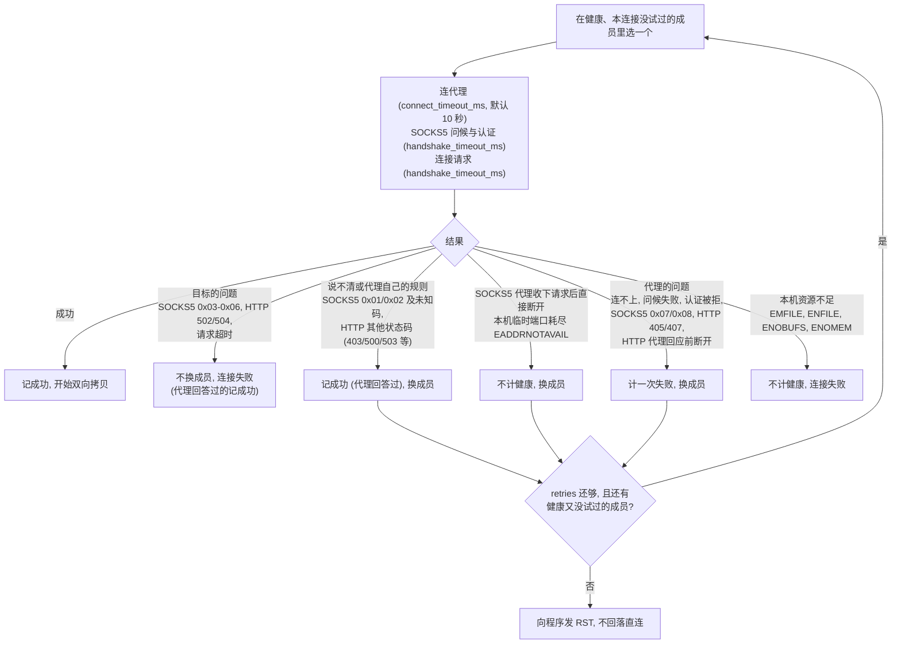
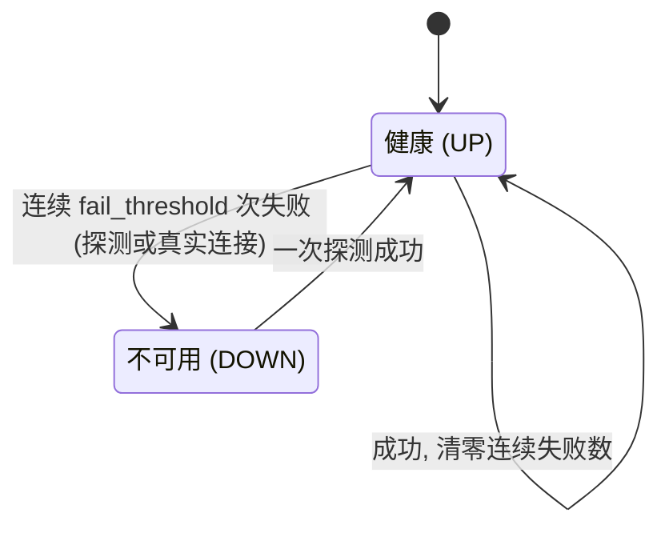

# proxytun 技术架构 · 7–8 负载均衡与运维

> [索引](../ARCHITECTURE.md) · [0 入门](primer.md) · [1–2 总览](overview.md) · [3.0–3.2 核心流程](flow.md) · [3.3–3.6 流程细节](flow-details.md) · [4 模块](modules.md) · [5 运行模式与 sudo 助手](privilege.md) · [6 进程、信号与生命周期](lifecycle.md) · **7–8 负载均衡与运维**

## 7. 选路、故障转移与健康检查

### 7.1 节点选择

规则判定为 `proxy` 后，中继在对应代理组里选一个节点。选择只读原子量(健康标志、活跃连接数、延迟)、不加锁，开销与组内成员数成正比。
六种策略(`round-robin`、`random`、`least-conn`、`least-latency`、`weighted-round-robin`、`hash`)的行为见 [CONFIG.md 第 6 节](../CONFIG.md#6-groups-代理组与负载均衡)。
每次只在"健康、且这条连接还没试过"的成员里选。

### 7.2 握手与失败分类

只有代理自己的问题才计为它的失败;目标的问题、本机资源不足不算(代理回答过的还记一次成功)。代理只在目标有了结果后才回连接请求(squid、ssh -D、dante),
所以请求发出后的超时是目标的问题，否则连一个黑洞地址就能把整组代理标成 DOWN,程序还要等每个成员各超时一次。

- 重试只发生在握手阶段：这时程序的数据一个字节都还没发出，换成员是安全的。
- SOCKS5 代理构造不出请求的目标(空域名、超过 255 字节的域名)在连代理之前就失败，不计入任何节点。
- `ssh -D` 连不上目标时会收下请求后直接断开：这不算代理故障(否则连续几个连不上的目标就会让它 DOWN、所有连接一起失败),
  而别的成员(别的服务器)也许到得了，所以换成员。
- 已知限制：关闭了 IPv6 的主机上配置 IPv6 代理，连接它得到的 EADDRNOTAVAIL 也被当成端口耗尽，节点永远不会 DOWN
  (每条连接先试它一次，立即失败后换成员)。

### 7.3 健康检查

- 启动和热加载时立即探测一次，之后每轮结束后隔 `interval_secs` 秒再探测;每轮并发探测所有代理，一个不应答的代理只耗它自己的超时。探测：与代理建立 TCP 连接;SOCKS5 代理再做一次与真实连接相同的问候
  (含认证),被拒或不接受任何方法都算失败;HTTP 代理只建 TCP 连接。
- 探测往返时间做指数加权平均(新样本占 0.3),供 `least-latency` 使用。延迟只来自探测，衡量的是到代理这一跳;真实连接只更新健康状态。
- 本机资源不足时探测跳过，不计为失败。
- 组内成员全部 DOWN 时，走这个组的连接直接失败(`no healthy proxy available`),不会直连。

## 8. 运维

### 8.1 热加载

`kill -HUP <proxytun pid>` 重新读配置(含 `--proxy` / `PROXYTUN_PROXY` 的覆盖),校验通过后整体替换规则与代理组，并按新的 `[health]` 重启健康探测;
各代理的健康状态和统计从头开始。已经建立的连接不受影响。`fake_ip_range`、`upstream_dns`、主机端口转发需要重启。
配置有错则保留旧配置，日志里有 `reload failed`。

### 8.2 统计

`kill -USR1 <proxytun pid>` 在日志里打印三类信息:

| 行 | 内容 |
|---|---|
| `stats` | 当前值:`fake_ips`、`nat_entries`、`active`;累计计数:`connections`、`relayed_up` / `relayed_down`、`dns_queries`、`dns_forwarded`、`dns_forward_failed`、`udp_refused`、TUN 收发的包数与字节数，以及按原因分开的丢弃:`dropped_unparsed`、`dropped_other_proto`、`dropped_no_flow`、`dropped_table_full`、`relays_refused`、`dropped_dns_busy` |
| `rates since the previous stats` | 距上次打印的每秒速率：新连接、TUN 收包数与流量、上下行流量 |
| 每个代理一行 | 健康状态、活跃连接数、延迟、成功与失败次数 |

字节数由包在两个 socket 外的计数器边转发边累加，长连接在结束前就能在统计里看到。

### 8.3 日志

每条连接一个递增编号，日志里写作 `conn{id=… target=…}`;info 级别下每条连接两行：开始时的选路结果，结束时的汇总
(`closed ms dial_ms via up down`,失败时写原因)。代理故障引起的重试默认以 warn 记录;`-v` 增加每条 DNS 查询，以及目标被拒、代理断开等不计健康的重试原因;`-vv` 增加 TUN 上的每个 SYN 与它改写用的地址。
会按包、按查询、按 accept 频率重复的告警(表满、池满、fd 用尽)限速为每 10 秒一条，计数照常。

### 8.4 各类上限与耗尽时的行为

| 资源 | 上限 | 耗尽时 |
|---|---|---|
| proxytun 的打开文件数 | 启动程序后把软上限提到 min(硬上限, `fs.nr_open`);程序拿到的仍是原值 | 见下面两行 |
| 同时中继的连接 | 8192;两个 fd 一条，先留出 64 + 主机端口数 + 256 + 32 个 fd(最多留一半),fd 上限低时更少(启动时 warn) | 新连接立即 RST(`relays_refused`),程序马上失败 |
| 地址改写表 | 约 103 万条(含关闭后保留 75 秒的),持续约每秒 1.37 万条新连接;满表约 200–280 MB | 新连接的 SYN 立即 RST(ECONNREFUSED,`dropped_table_full`) |
| 排队等 accept 的连接 | 30 秒 | 向程序发 RST |
| 同时处理的 DNS 查询 | 1024 | 丢弃(`dropped_dns_busy`),解析器重试 |
| 同时转发上游的 DNS 查询 | 256,每个最长 3 秒 | 丢弃，解析器重试 |
| 假 IP 映射 | 100 万条(约 280 MB) | 回收不了时答 SERVFAIL |
| direct 规则的域名解析 | 同时 32 个 | 该连接立即失败 |
| tokio 阻塞线程 | 64(都占用户的进程数额度) | 排队 |
| 新网络命名空间的 `somaxconn` | root 与 sudo 模式调到 4096(5.4 以前的内核默认 128) | 内核丢 SYN,程序重传 |

本机资源不足(EMFILE、ENFILE、ENOBUFS、ENOMEM、本机临时端口耗尽)从不算作代理故障，连接和健康探测都不计入，否则 fd 用尽会把健康的代理标成 DOWN。
