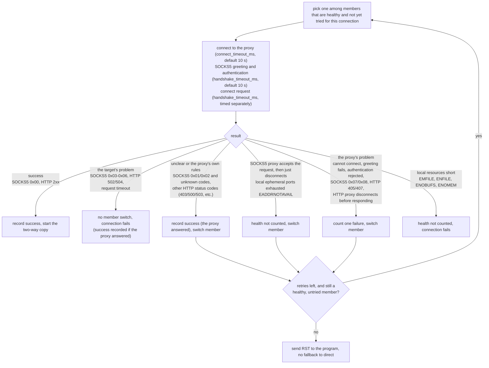
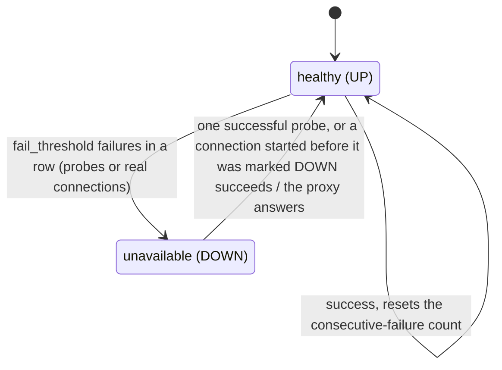

# proxytun architecture · 7–8 Load balancing and operations

[简体中文](operations.md) · **English**

> [Index](../ARCHITECTURE_en.md) · [0 Primer](primer_en.md) · [1–2 Overview](overview_en.md) · [3.0–3.2 Core flows](flow_en.md) · [3.3–3.6 Flow details](flow-details_en.md) · [4 Modules](modules_en.md) · [5 Run modes and the sudo helper](privilege_en.md) · [6 Processes, signals and lifecycle](lifecycle_en.md) · **7–8 Load balancing and operations**

## 7. Routing, failover and health checks

### 7.1 Node selection

Once the rules decide `proxy`, the relay picks a node in the corresponding proxy group. Selection reads only atomics (health flag, active connections, latency) and takes no locks; its cost is proportional to the number of members in the group.
For how the six strategies (`round-robin`, `random`, `least-conn`, `least-latency`, `weighted-round-robin`, `hash`) behave, see [CONFIG.md section 6](../CONFIG_en.md#6-groups-proxy-groups-and-load-balancing).
Each pick is made only among members that are "healthy and not yet tried for this connection".

### 7.2 Handshakes and failure classes

Only the proxy's own problems count as its failures; the target's problems and local resource shortages do not (a success is still recorded if the proxy answered). Proxies answer the connect request only once the target has a result (squid, ssh -D, dante),
so a timeout after the request is sent is the target's problem; otherwise connecting to one black-hole address could mark a whole group of proxies DOWN, and the program would also wait for each member to time out in turn.

- Retries happen only during the handshake: at that point not one byte of the program's data has been sent, so switching members is safe.
- A target that cannot be put in a SOCKS5 request (an empty domain name, a domain name longer than 255 bytes) fails before the proxy is connected to and counts against no node.
- When `ssh -D` cannot reach the target it accepts the request and then just disconnects: this does not count as a proxy fault (otherwise a few unreachable targets in a row would mark it DOWN and fail every connection together),
  but another member (another server) may be able to reach the target, so the member is switched.
- Known limitation: with an IPv6 proxy configured on a host with IPv6 disabled, the EADDRNOTAVAIL from connecting to it is also taken as port exhaustion, so the node is never marked DOWN
  (each connection first tries it once, fails immediately, then switches member).

### 7.3 Health checks

- One probe runs immediately at startup and on hot reload, then again `interval_secs` seconds after each round ends; each round probes all proxies concurrently, so a proxy that does not answer costs only its own timeout. A probe: a TCP connection to the proxy; for a SOCKS5 proxy, also the same greeting as a real connection
  (with authentication), where a rejection or no acceptable method counts as a failure; for an HTTP proxy, only the TCP connection.
- Probe round-trip times are averaged with exponential weighting (new sample weight 0.3) for `least-latency`. Latency comes only from probes and measures the hop to the proxy; real connections update only the health state.
- When local resources are short, the probe is skipped and not counted as a failure.
- When every member of a group is DOWN, connections routed to that group fail at once (`no healthy proxy available`); they do not go direct.

## 8. Operations

### 8.1 Hot reload

`kill -HUP <proxytun pid>` rereads the config (including the `--proxy` / `PROXYTUN_PROXY` override); once it validates, the rules and proxy groups are replaced as a whole and health probing restarts with the new `[health]`;
each proxy's health state and stats start from scratch. Established connections are not affected. `fake_ip_range`, `upstream_dns` and host port forwarding need a restart.
If the config has errors, the old config is kept and the log shows `reload failed`.

### 8.2 Stats

`kill -USR1 <proxytun pid>` prints three kinds of information to the log:

| Line | Contents |
|---|---|
| `stats` | Current values: `fake_ips`, `nat_entries`, `active`; cumulative counters: `connections`, `relayed_up` / `relayed_down`, `dns_queries`, `dns_forwarded`, `dns_forward_failed`, `udp_refused`, packets and bytes received and sent on the TUN, and drops by reason: `dropped_unparsed`, `dropped_other_proto`, `dropped_no_flow`, `dropped_table_full`, `relays_refused`, `dropped_dns_busy` |
| `rates since the previous stats` | Per-second rates since the previous print: new connections, TUN packets received and their traffic, upstream and downstream traffic |
| One line per proxy | Health state, active connections, latency, success and failure counts |

Byte counts are accumulated as data is forwarded, by counters wrapped around the two sockets, so long-lived connections show up in the stats before they end.

### 8.3 Logs

Each connection gets an increasing number, written in the log as `conn{id=… target=…}`; at info level each connection has two lines: the routing result at the start, and a summary at the end
(`closed ms dial_ms via up down`, with the reason on failure). Member switches caused by proxy faults and by local ephemeral port exhaustion (EADDRNOTAVAIL) are logged at warn by default; `-v` adds every DNS query, plus the reasons for failures that do not count toward health, such as the target refused (no member switch) or the proxy disconnecting; `-vv` adds every SYN on the TUN and the address used to rewrite it.
Warnings that would repeat at per-packet, per-query or per-accept rates (table full, pool full, fds exhausted) are limited to one per 10 seconds; a full table is still counted in `dropped_table_full` as usual.

### 8.4 Limits and behavior when exhausted

| Resource | Limit | When exhausted |
|---|---|---|
| proxytun's open files | After starting the program, the soft limit is raised to min(hard limit, `fs.nr_open`); the program still gets the original value | See the next two rows |
| Connections relayed at once | 8192; two fds per connection, after first reserving 64 + number of host ports + 256 + 32 fds (at most half reserved); fewer when the fd limit is low (warn at startup) | New connections get an immediate RST (`relays_refused`), the program fails at once |
| NAT table | About 1.03 million entries (including those kept for 75 seconds after close), sustaining about 13,800 new connections per second; a full table is about 200–280 MB | The SYN of a new connection gets an immediate RST (ECONNREFUSED, `dropped_table_full`) |
| Connections queued for accept | 30 seconds | RST sent to the program |
| DNS queries handled at once | 1024 | Dropped (`dropped_dns_busy`), the resolver retries |
| DNS queries forwarded upstream at once | 256, each at most 3 seconds | Dropped, the resolver retries |
| Fake IP mappings | 2^20 (about 1.05 million) entries (about 280 MB) | SERVFAIL when none can be reclaimed |
| Domain resolution for direct rules | 32 at once | That connection fails at once |
| tokio blocking threads | 64 (all count against the user's process quota) | Queued |
| `somaxconn` of the new network namespace | Raised to 4096 in root and sudo modes (kernels before 5.4 default to 128) | The kernel drops SYNs, the program retransmits |

Local resource shortages (EMFILE, ENFILE, ENOBUFS, ENOMEM, local ephemeral port exhaustion) never count as proxy faults, for connections and health probes alike; otherwise running out of fds would mark healthy proxies DOWN.
