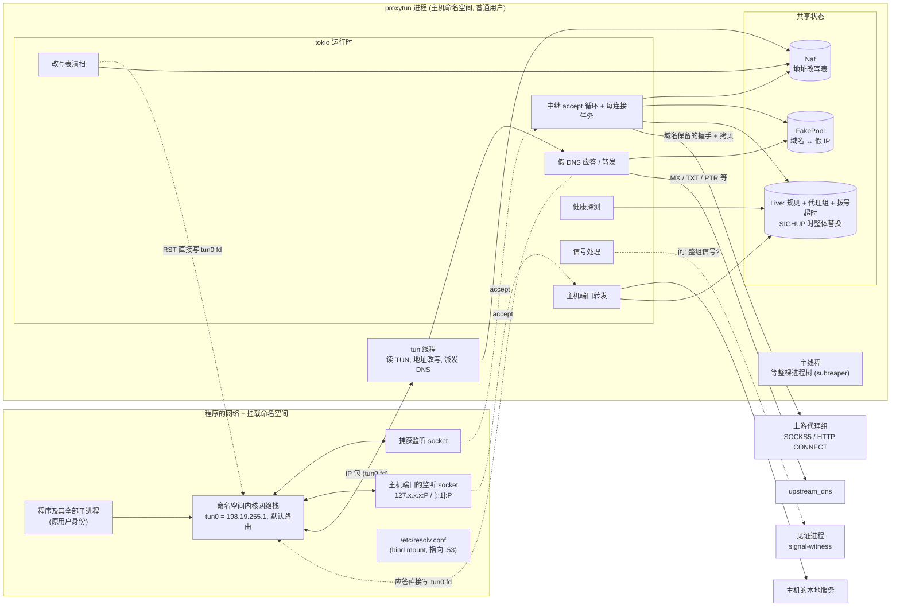

# proxytun 技术架构 · 1–2 要解决的问题与总体架构

**简体中文** · [English](overview_en.md)

> [索引](../ARCHITECTURE.md) · [0 入门](primer.md) · **1–2 总览** · [3.0–3.2 核心流程](flow.md) · [3.3–3.6 流程细节](flow-details.md) · [4 模块](modules.md) · [5 运行模式与 sudo 助手](privilege.md) · [6 进程、信号与生命周期](lifecycle.md) · [7–8 负载均衡与运维](operations.md)

## 1. 要解决的问题

让**指定的程序及其全部子进程**的 TCP 连接走 SOCKS5 / HTTP 代理，并且**把域名一路带到代理**,让 Clash / sing-box 能按域名分流;
同时不妨碍 strace、gdb、ltrace,并且能在 CentOS 7(内核 3.10、glibc 2.17)上用。

| 方案 | 为什么不行 |
|---|---|
| proxychains-ng(LD_PRELOAD) | 静态链接程序无效;程序启动子进程时清空 `LD_PRELOAD` 就逃出去了 |
| proxyhook(ptrace) | 一个进程同一时刻只能有一个 tracer,不能与 strace / gdb / ltrace 共存 |
| tun2proxy `--unshare` | 依赖新版 util-linux 和非特权 user namespace,CentOS 7 上都没有;所有 TCP 都经代理，不处理本机回环服务 |
| 全局 TUN / 透明代理 | 需要 root,并且接管整台机器的流量 |

proxytun = **私有网络命名空间 + TUN + 用户态地址改写 + fake-ip DNS**:

1. 程序跑在一个私有网络命名空间里，唯一的出口是 proxytun 持有的 TUN 设备;命名空间是进程属性，整棵进程树都在里面。
2. 程序问 DNS → 假 DNS 给它一个假 IP(`198.18.0.0/15`),并记住 `假IP ↔ 域名`。
3. 程序连假 IP → 包从 TUN 出来 → proxytun 改写地址交给命名空间里的监听 socket,内核完成 TCP → 中继反查回域名，
   用 SOCKS5 `ATYP=0x03`(域名)或 HTTP `CONNECT host:port` 交给代理。

没有 ptrace,所以调试工具照常可用;不改主机网络，所以不需要 root(没有非特权 user namespace 时，只在建命名空间那一刻借用 sudo)。

## 2. 总体架构

要点:

- **所有出网的连接都由主机侧的 proxytun 发起。** 程序的包只到 TUN;连代理、直连目标、转发 DNS、连主机的本地服务，都是 proxytun 在主机命名空间里做的。
- **TUN 线程是独立的 OS 线程**(阻塞读 TUN,`top -H` 里名为 `tun`)。命名空间里的 TCP 处理落在它写回改写后的包的 `write` 上，它是整个数据面的瓶颈(见 [PERFORMANCE.md](../PERFORMANCE.md))。
  DNS 查询可能要几秒(转发上游),所以 TUN 线程只把查询交给 tokio 运行时，从不等待;DNS 应答和清扫发出的 RST 由 tokio 线程直接写 TUN。
- **中继、DNS、健康探测、信号都在 tokio 运行时里**;TUN 线程与它们通过共享状态通信：地址改写表(`Mutex`)、假 IP 池(`Mutex`)、
  规则与代理组(`RwLock`,热加载时整体替换)、统计计数(原子量)。
- **启动完成后，主线程只做一件事**:作为 subreaper 等程序的整棵进程树结束，然后以程序的退出方式结束自己(第 6 节)。
- **准备进程 / 特权助手只在启动时存在。** 它们建好命名空间、把 TUN 和监听 socket 的 fd 交给 proxytun,随后 exec 成程序(或退出),
  之后整棵树里没有 root 进程(第 5 节)。
- **proxytun 退出时 TUN 随之消失**,程序只剩回环，不会绕过代理直连。
