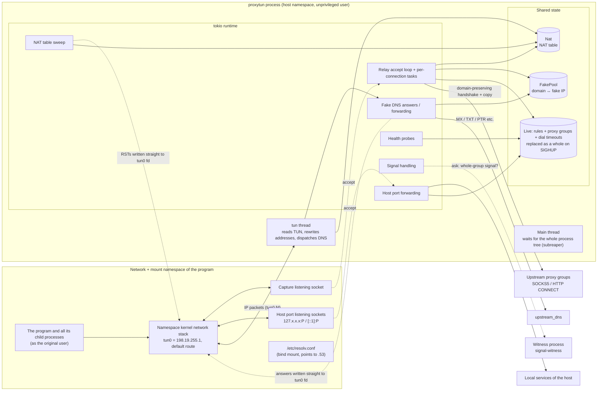

# proxytun architecture · 1–2 The problem to solve and the overall architecture

[简体中文](overview.md) · **English**

> [Index](../ARCHITECTURE_en.md) · [0 Primer](primer_en.md) · **1–2 Overview** · [3.0–3.2 Core flows](flow_en.md) · [3.3–3.6 Flow details](flow-details_en.md) · [4 Modules](modules_en.md) · [5 Run modes and the sudo helper](privilege_en.md) · [6 Processes, signals and lifecycle](lifecycle_en.md) · [7–8 Load balancing and operations](operations_en.md)

## 1. The problem to solve

Send the TCP connections of **a given program and all its child processes** through a SOCKS5 / HTTP proxy, and **carry domain names all the way to the proxy**, so Clash / sing-box can route by domain,
while not getting in the way of strace, gdb or ltrace, and working on CentOS 7 (kernel 3.10, glibc 2.17).

| Approach | Why it does not work |
|---|---|
| proxychains-ng (LD_PRELOAD) | No effect on statically linked programs; a program that clears `LD_PRELOAD` when starting a child process escapes |
| proxyhook (ptrace) | A process can have only one tracer at a time, so it cannot coexist with strace / gdb / ltrace |
| tun2proxy `--unshare` | Needs a recent util-linux and unprivileged user namespaces, neither of which CentOS 7 has; all TCP goes through the proxy, with no handling of local loopback services |
| Global TUN / transparent proxy | Needs root, and takes over the whole machine's traffic |

proxytun = **private network namespace + TUN + user-space address rewriting + fake-ip DNS**:

1. The program runs in a private network namespace whose only exit is a TUN device held by proxytun. The namespace is a process attribute, so the whole process tree is inside it.
2. The program asks DNS → fake DNS gives it a fake IP (`198.18.0.0/15`) and remembers `fake IP ↔ domain`.
3. The program connects to the fake IP → the packets come out of the TUN device → proxytun rewrites the addresses and hands them to the listening socket in the namespace, and the kernel does TCP → the relay maps back to the domain
   and hands it to the proxy with SOCKS5 `ATYP=0x03` (domain name) or HTTP `CONNECT host:port`.

No ptrace, so debugging tools work as usual. The host network is not changed, so no root is needed (without unprivileged user namespaces, sudo is borrowed only at the moment the namespaces are created).

## 2. Overall architecture

Key points:

- **Every outbound connection is made by proxytun on the host side.** The program's packets only reach the TUN device; connecting to proxies, connecting directly to targets, forwarding DNS and connecting to the host's local services are all done by proxytun in the host namespace.
- **The TUN thread is a separate OS thread** (blocking reads on TUN, named `tun` in `top -H`). The namespace's TCP processing happens in its `write`s of the rewritten packets, which makes it the bottleneck of the whole data plane (see [PERFORMANCE.md](../PERFORMANCE_en.md)).
  A DNS query can take seconds (when forwarded upstream), so the TUN thread only hands queries to the tokio runtime and never waits; DNS answers and the RSTs sent by the sweep are written to TUN directly by tokio threads.
- **Relay, DNS, health probes and signals all run in the tokio runtime.** The TUN thread talks to them through shared state: the NAT table (`Mutex`), the fake IP pool (`Mutex`),
  rules and proxy groups (`RwLock`, replaced as a whole on hot reload), and stats counters (atomics).
- **Once startup is done, the main thread does only one thing:** as the subreaper, it waits for the program's whole process tree to finish, then ends itself the same way the program exited (section 6).
- **The setup process / privileged helper exists only during startup.** It creates the namespaces, hands the fds of the TUN device and listening sockets to proxytun, then execs into the program (or exits);
  after that there is no root process anywhere in the tree (section 5).
- **When proxytun exits, the TUN device goes with it**; the program is left with only loopback and never bypasses the proxy to connect directly.
