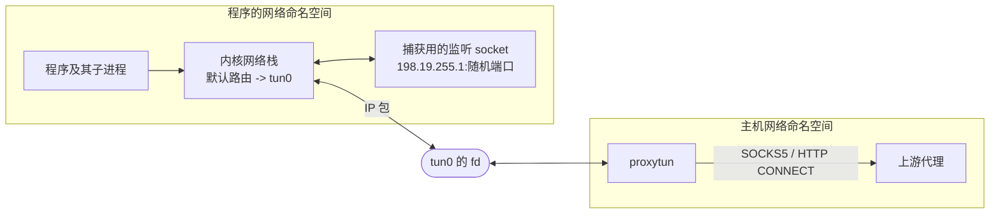

# proxytun 技术架构 · 0 入门

**简体中文** · [English](primer_en.md)

> [索引](../ARCHITECTURE.md) · **0 入门** · [1–2 总览](overview.md) · [3.0–3.2 核心流程](flow.md) · [3.3–3.6 流程细节](flow-details.md) · [4 模块](modules.md) · [5 运行模式与 sudo 助手](privilege.md) · [6 进程、信号与生命周期](lifecycle.md) · [7–8 负载均衡与运维](operations.md)

本节给没接触过网络命名空间、TUN 的读者，只讲读懂后面各节所需的最少概念。

## 0.1 网络命名空间

Linux 的网络栈(网卡、IP 地址、路由表、回环、监听的端口)可以有多份，每一份叫一个**网络命名空间**。
每个进程属于其中一个;`fork` / `exec` 时子进程继承父进程的命名空间，与程序怎么链接、环境变量是什么、有没有调试器都无关。

proxytun 正是利用这一点：把程序放进一个新建的网络命名空间，那里唯一的出口是 proxytun 持有的 TUN 设备。
程序和它启动的所有子孙进程，不管做什么，只能经过这个出口联网。

命名空间里的 `127.0.0.1` 也是自己的一份，和主机的回环不通。所以 proxytun 要专门把主机上的本地服务"开进"命名空间(主机端口转发，见 3.5)。

## 0.2 user namespace 与能力

建网络命名空间、建 TUN 设备、配地址和路由，都需要 `CAP_NET_ADMIN` 这类能力。普通用户可以先建一个 **user namespace**:
在它里面自己就是 "root",拥有全部能力，但这些能力只对这个 user namespace 拥有的资源(随后建的网络、挂载命名空间)有效，对主机无效。
`/proc/self/uid_map` 把命名空间里的 uid 映射回主机上的真实 uid;proxytun 把自己的 uid 映射成自己，所以程序在里面看到的仍是原来的 uid。

程序 `exec` 时，因为它的 uid 不是 0,内核会清掉它在命名空间里的能力：程序和平时一样是普通用户。

有的系统不允许普通用户建 user namespace:CentOS 7 默认 `user.max_user_namespaces=0`,Ubuntu 24.04 的 AppArmor 会收走其中的能力。
这时 proxytun 改用 sudo 启动一个短命的特权助手来建命名空间(第 5 节)。

## 0.3 挂载命名空间与 bind mount

程序解析域名时读 `/etc/resolv.conf`。proxytun 不能改主机上的这个文件，所以同时建一个**挂载命名空间**(挂载点列表的私有副本),
在里面把一个自己写的文件 bind mount 到 `/etc/resolv.conf` 上:命名空间里看到的是它，主机上的文件不变。

## 0.4 TUN 设备

TUN 是一块虚拟网卡。内核把路由到它的 IP 包交给持有它的 fd 的进程(`read` 得到一个完整的 IP 包);进程 `write` 一个 IP 包，
内核就当作这块网卡收到了它。proxytun 在命名空间里建 `tun0`、设成默认路由，然后在主机侧读写它的 fd,离开命名空间(路由到 `tun0`)的每个包都经过 proxytun;命名空间内部的回环流量走 `lo`,不经过它。

TUN 不设持久标志，持有它的最后一个 fd 关闭时内核就把它删掉;命名空间没有名字，最后一个引用消失时也被销毁。所以 proxytun 退出(包括崩溃、`kill -9`)后，
主机上不留下任何网卡、路由或配置，程序则只剩回环、等于断网，不会绕过代理直连。

## 0.5 用户态地址改写

proxytun 不在用户态实现 TCP。它只改写从 TUN 读到的包的地址和端口，把程序发往 `目标:端口` 的连接导向命名空间里自己的一个监听 socket,
再把监听 socket 的回包改写回来。TCP 的握手、重传、窗口都由内核完成，proxytun 从监听 socket `accept` 到的是一条普通的 TCP 连接，
再按改写表查回原来的目标。这个思路与 Clash、sing-box 的 "system stack" 相同，不需要 netfilter(CentOS 7 的 3.10 内核没有 nftables)。

## 0.6 其他用到的内核机制

| 机制 | 用途 |
|---|---|
| `SCM_RIGHTS` | 在 unix socket 上把 fd 传给另一个进程:准备进程(或 sudo 助手)把建好的 TUN fd 和监听 socket 交给 proxytun |
| `PR_SET_CHILD_SUBREAPER` | 程序的孤儿进程过继给 proxytun 而不是 init,proxytun 能等整棵进程树都结束再退出 |
| `signalfd` | 以读 fd 的方式收 SIGINT/SIGQUIT/SIGTERM,能看到发送者的 `si_code`(终端发的还是进程发的) |
| `PR_SET_DUMPABLE 0` | proxytun 保存着代理凭据，设为 non-dumpable 后同一用户的其他进程(包括被代理的程序)读不到它的内存 |
| `PR_SET_NO_NEW_PRIVS` | sudo 模式下程序带着它:命名空间里的网络由用户控制,setuid 程序不能在里面重新拿到 root |

## 0.7 术语表

| 术语 | 含义 |
|---|---|
| 假 IP | 假 DNS 给程序的"域名答案",取自 `fake_ip_range`(默认 `198.18.0.0/15`)。程序连它时，proxytun 反查回域名 |
| 命名空间内部地址 | `fake_ip_range` 最后一个 /24:`.1` 是 TUN(也是捕获监听的地址),`.53` 是假 DNS,`.2`–`.17` 是地址改写用的源地址 |
| 地址改写表(NAT 表) | 记录"改写用的源地址:端口 ↔ 程序的原始连接"的表，每条程序的 TCP 连接一个条目 |
| 捕获监听 | 命名空间里 proxytun 的监听 socket,被改写的 TCP 连接都由它 accept |
| 中继 | accept 之后把连接交给代理、直连或丢弃，并在两端之间搬运数据的部分 |
| 准备进程 | proxytun fork 后重新 exec 的自己(`__proxytun_setup`),负责建命名空间，之后 exec 成程序 |
| 特权助手 | sudo 模式下由 sudo 启动的 root 进程(`__proxytun_root_setup`),建好命名空间后立即退出 |
| 见证进程 | 与 proxytun 同一进程组的小进程(`signal-witness`),帮 proxytun 判断一个信号是不是发给了整个进程组 |
| 主机端口转发 | 把主机上监听回环或通配地址(`0.0.0.0`、`[::]`)的 TCP 端口在命名空间的回环地址上开出来，连接转到主机 |
| LINGER | 地址改写表的条目在连接关闭后保留 75 秒，让两端内核最后的 FIN/ACK 还能被改写 |
| fail-closed | 代理不可用时连接失败，而不是回落到直连 |
