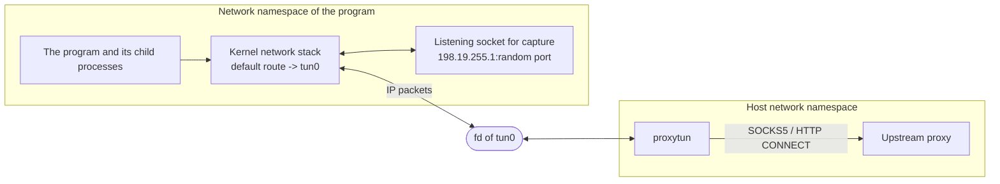

# proxytun architecture · 0 Primer

[简体中文](primer.md) · **English**

> [Index](../ARCHITECTURE_en.md) · **0 Primer** · [1–2 Overview](overview_en.md) · [3.0–3.2 Core flows](flow_en.md) · [3.3–3.6 Flow details](flow-details_en.md) · [4 Modules](modules_en.md) · [5 Run modes and the sudo helper](privilege_en.md) · [6 Processes, signals and lifecycle](lifecycle_en.md) · [7–8 Load balancing and operations](operations_en.md)

This section is for readers new to network namespaces and TUN. It covers only the minimum concepts needed to read the later sections.

## 0.1 Network namespaces

Linux can have several copies of its network stack (network interfaces, IP addresses, routing tables, loopback, listening ports); each copy is a **network namespace**.
Every process belongs to one of them. On `fork` / `exec` the child inherits the parent's namespace, regardless of how the program is linked, what its environment variables are, or whether a debugger is attached.

proxytun relies on exactly this: it puts the program into a new network namespace whose only exit is a TUN device that proxytun holds.
Whatever they do, the program and all its descendants can reach the network only through this exit.

The namespace also has its own `127.0.0.1`, not connected to the host's loopback. So proxytun has to explicitly "open" the host's local services inside the namespace (host port forwarding, see 3.5).

## 0.2 User namespaces and capabilities

Creating a network namespace, creating a TUN device, and configuring addresses and routes all need capabilities such as `CAP_NET_ADMIN`. An unprivileged user can first create a **user namespace**:
inside it the user is "root" with all capabilities, but those capabilities apply only to resources the user namespace owns (the network and mount namespaces created afterwards), not to the host.
`/proc/self/uid_map` maps uids in the namespace back to real uids on the host. proxytun maps its own uid to itself, so the program inside still sees its original uid.

When the program is `exec`ed, its uid is not 0, so the kernel clears its capabilities in the namespace: the program is an ordinary user, as usual.

Some systems do not let unprivileged users create user namespaces: CentOS 7 defaults to `user.max_user_namespaces=0`, and AppArmor on Ubuntu 24.04 takes away the capabilities inside them.
There proxytun instead uses sudo to start a short-lived privileged helper that creates the namespaces (section 5).

## 0.3 Mount namespaces and bind mounts

To resolve domain names the program reads `/etc/resolv.conf`. proxytun cannot change that file on the host, so it also creates a **mount namespace** (a private copy of the mount list),
and inside it bind mounts a file it wrote onto `/etc/resolv.conf`: the namespace sees that file, and the host's file is unchanged.

## 0.4 TUN devices

A TUN device is a virtual network interface. The kernel hands IP packets routed to it to the process holding its fd (a `read` returns one whole IP packet); when the process `write`s an IP packet,
the kernel treats it as received on that interface. proxytun creates `tun0` in the namespace, makes it the default route, then reads and writes its fd on the host side. Every packet leaving the namespace (routed to `tun0`) passes through proxytun; loopback traffic inside the namespace goes over `lo` and does not.

The TUN device has no persistent flag, so the kernel deletes it when the last fd holding it closes. The namespace has no name, so it too is destroyed when its last reference goes away. So after proxytun exits (including a crash or `kill -9`),
no interface, route or configuration is left on the host, and the program is left with only loopback, i.e. offline; it never bypasses the proxy and connects directly.

## 0.5 User-space address rewriting

proxytun does not implement TCP in user space. It only rewrites the addresses and ports of packets read from the TUN device, steering the program's connections to `target:port` to a listening socket of its own in the namespace,
and rewrites the listening socket's replies back. The kernel does the TCP handshake, retransmission and windowing; what proxytun `accept`s from the listening socket is an ordinary TCP connection,
and it looks up the original target in the NAT table. This is the same idea as the "system stack" of Clash and sing-box, and needs no netfilter (CentOS 7's 3.10 kernel has no nftables).

## 0.6 Other kernel mechanisms used

| Mechanism | Purpose |
|---|---|
| `SCM_RIGHTS` | Passes fds to another process over a unix socket: the setup process (or the sudo helper) hands the TUN fd and listening sockets it created to proxytun |
| `PR_SET_CHILD_SUBREAPER` | The program's orphaned processes are reparented to proxytun instead of init, so proxytun can wait for the whole process tree to finish before exiting |
| `signalfd` | Receives SIGINT/SIGQUIT/SIGTERM by reading an fd, and sees the sender's `si_code` (sent by the terminal or by a process) |
| `PR_SET_DUMPABLE 0` | proxytun holds proxy credentials; once it is non-dumpable, other processes of the same user (including the proxied program) cannot read its memory |
| `PR_SET_NO_NEW_PRIVS` | The program runs with it in sudo mode: the user controls the network in the namespace, so a setuid program cannot regain root in there |

## 0.7 Glossary

| Term | Meaning |
|---|---|
| Fake IP | The "domain answer" fake DNS gives the program, taken from `fake_ip_range` (default `198.18.0.0/15`). When the program connects to it, proxytun maps it back to the domain |
| Namespace-internal addresses | The last /24 of `fake_ip_range`: `.1` is the TUN device (also the capture listener's address), `.53` is fake DNS, `.2`–`.17` are the NAT source addresses used for address rewriting |
| NAT table | The table recording "NAT source address:port ↔ the program's original connection", one entry per TCP connection of the program |
| Capture listener | proxytun's listening socket in the namespace; every rewritten TCP connection is accepted by it |
| Relay | The part that, after accept, hands the connection to a proxy, connects directly or drops it, and moves data between the two ends |
| Setup process | proxytun itself, re-exec'd after a fork (`__proxytun_setup`); it creates the namespaces, then execs into the program |
| Privileged helper | The root process started by sudo in sudo mode (`__proxytun_root_setup`); it exits as soon as the namespaces are created |
| Witness process | A small process in proxytun's process group (`signal-witness`) that helps proxytun tell whether a signal was sent to the whole process group |
| Host port forwarding | Makes host TCP ports that listen on loopback or wildcard addresses (`0.0.0.0`, `[::]`) available on the namespace's loopback addresses, with connections forwarded to the host |
| LINGER | A NAT table entry is kept for 75 seconds after its connection closes, so the final FIN/ACK of the kernels on both ends can still be rewritten |
| fail-closed | When the proxy is unavailable, the connection fails instead of falling back to a direct connection |
