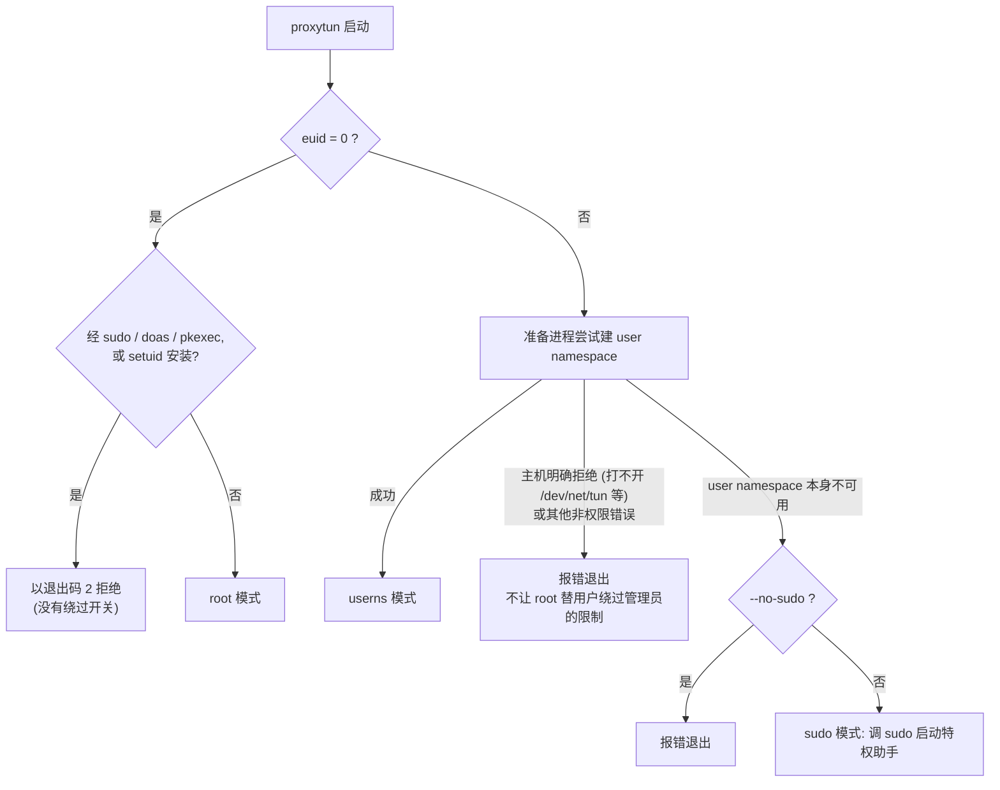
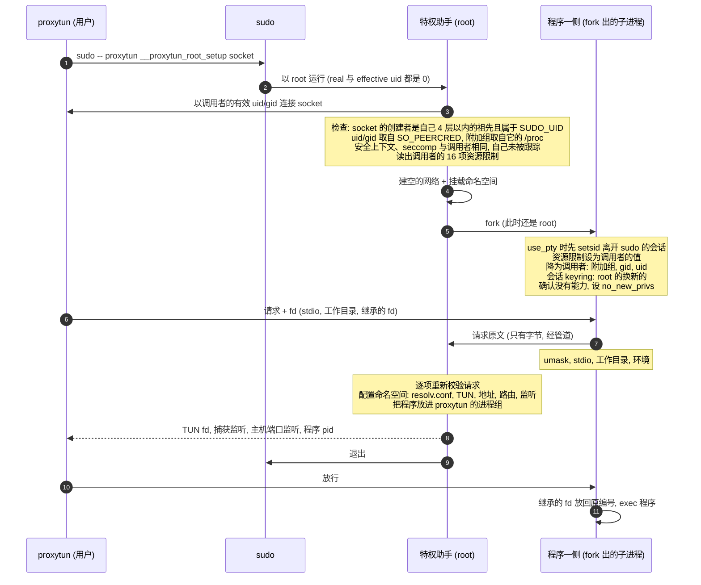

# proxytun 技术架构 · 5 运行模式与 sudo 助手

> [索引](../ARCHITECTURE.md) · [0 入门](primer.md) · [1–2 总览](overview.md) · [3.0–3.2 核心流程](flow.md) · [3.3–3.6 流程细节](flow-details.md) · [4 模块](modules.md) · **5 运行模式与 sudo 助手** · [6 进程、信号与生命周期](lifecycle.md) · [7–8 负载均衡与运维](operations.md)

## 5. 运行模式与 sudo 助手

### 5.1 三种模式

| 模式 | 什么时候 | 谁建命名空间 | 程序的身份 |
|---|---|---|---|
| userns | 有非特权 user namespace(大多数新发行版、WSL2) | 准备进程，无需任何权限 | 原用户(uid/gid 映射为自身),exec 后没有能力 |
| sudo | 没有(CentOS 7 默认、`max_user_namespaces=0`、AppArmor 收走能力) | sudo 启动的特权助手 | 原用户(含附加组),能力清空,`no_new_privs` |
| root | 以 root 登录(或 `su -`)后运行 | 准备进程(不建 user namespace) | root,能力完整 |



- **拒绝 `sudo proxytun`。** 除特权助手外,proxytun 的任何入口(含内部的 `__proxytun_setup`)在 euid 为 0 时，只要 real uid 不是 0
  (setuid 安装)或环境里有 `SUDO_UID` / `SUDO_USER` / `SUDO_COMMAND` / `DOAS_USER` / `PKEXEC_UID`,就拒绝。否则只放行 proxytun 的
  sudoers 规则就等于放行任意 root 命令(`sudo proxytun -- sh`)。其他提权方式(ksu、userhelper、`systemd-run --uid=0`)不留可识别的痕迹，
  所以只能用 sudo 授权 proxytun。
- **回退条件。** 只有 user namespace 本身的问题(建不了，或其中的能力被 LSM 收走，表现为 EPERM / EACCES)才回退到 sudo。

### 5.2 sudo 模式的流程

proxytun 在 0700 的私有目录里建一个 unix socket,运行 `sudo -- <proxytun 自己的绝对路径> __proxytun_root_setup <socket 路径>`
(sudo 会关闭 fd ≥ 3,所以只能传路径)。特权助手(root)按下图建好命名空间后立即退出。



要点(设计理由见 [DESIGN.md 第 3 节](../DESIGN.md#3-权限模型)):

- **root 进程从不接收用户的 fd。** 关闭一个用户给的 fd 可能永久阻塞(设了 linger 且发不出去的 socket、用户 FUSE 挂载上的文件),
  root 助手和等它的 sudo 就会挂着。所以请求和 fd 由已经降为用户的程序一侧接收，再把请求原文经管道交给助手;助手从不自己关闭控制 socket,
  留给内核在退出时关闭。助手失败时 SIGKILL 程序一侧但不等它。
- **身份只来自内核。** 程序的 uid、gid 取自 socket 的 `SO_PEERCRED`,附加组取自创建者的 `/proc/<pid>/status`,不信任请求里自报的内容。
  socket 创建者必须是助手的祖先进程(还活着，pid 没被复用),否则直接断开、不发任何消息;还必须属于 `SUDO_UID` 且不是 root,否则回一条错误后退出。
- **请求逐项重新校验**:假 IP 段 /8–/22,进程组必须是调用者自己的，转发地址只能是回环、端口非 0 非 53、不重复、最多 250 个,
  继承的 fd 最多 249 个、编号小于 2^20。
- **超时。** 客户端 10 秒不说话，助手退出;等程序一侧回报最多再加 5 秒(那时它已是用户的进程，用户可以把它停住)。
- **程序的进程属性与 userns 模式一致**:调用者的资源限制(不带进 PAM / sudo 给 root 的不同限制)、umask、工作目录、环境变量、
  继承的 fd(按原编号)、调用方忽略的 SIGPIPE。会话 keyring:继承下来的属于调用者时保留(与 userns 模式一致);
  属于 root(pam_keyinit,RHEL 默认如此)或已失效时，换成用户自己的新 keyring。
- **拒绝运行的情况**:sudoers 设了 `ROLE` / `TYPE`(安全上下文与调用者不同);开了 `intercept` / `log_subcmds`(助手被跟踪或多了 seccomp 过滤器);
  keyctl 被过滤、看不出程序会拿到谁的会话 keyring(Docker 默认的 seccomp)。
- **use_pty。** sudo 把命令放进自己的伪终端会话，助手退出后会话首进程(sudo 的监控进程)随之退出，内核向这个终端的前台进程组发 SIGHUP。
  所以程序一侧先 `setsid()` 离开，经管道告知后助手才回报。此后程序没有控制终端,proxytun 负责把终端的 Ctrl+C 转给它的整个进程组(第 6 节)。

### 5.3 安装要求

sudo 以 root 执行的是 proxytun 自己的可执行文件，它必须放在只有 root 能写的位置(普通用户能改它，就等于能以 root 执行任意代码)。免密码的 sudoers 规则只放行特权助手：

```
alice ALL=(root) NOPASSWD: /usr/local/bin/proxytun __proxytun_root_setup *
```

多余的参数会被助手拒绝。助手只在 real 与 effective uid 都为 0 时运行(sudo 的做法);以 setuid 方式启动时 real uid 是调用者,
`SUDO_UID` 也由调用者设置，直接拒绝。
