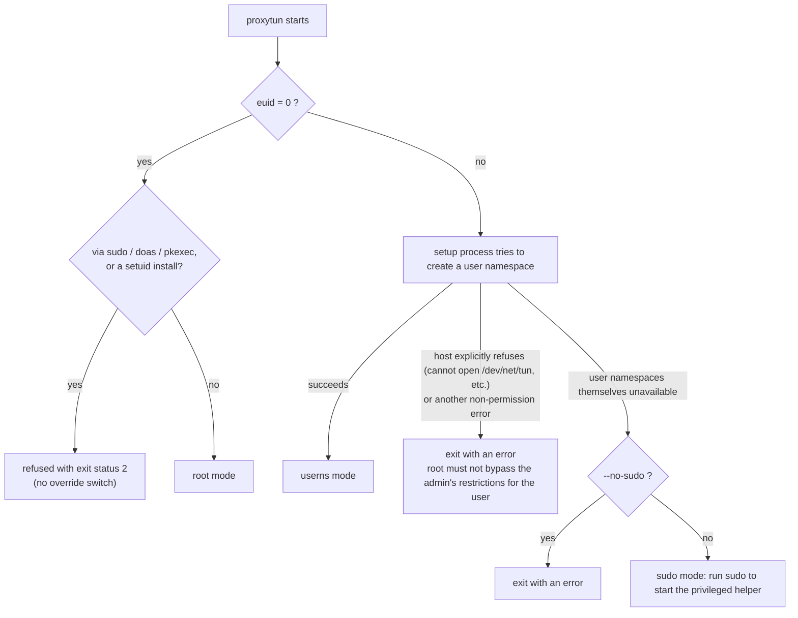
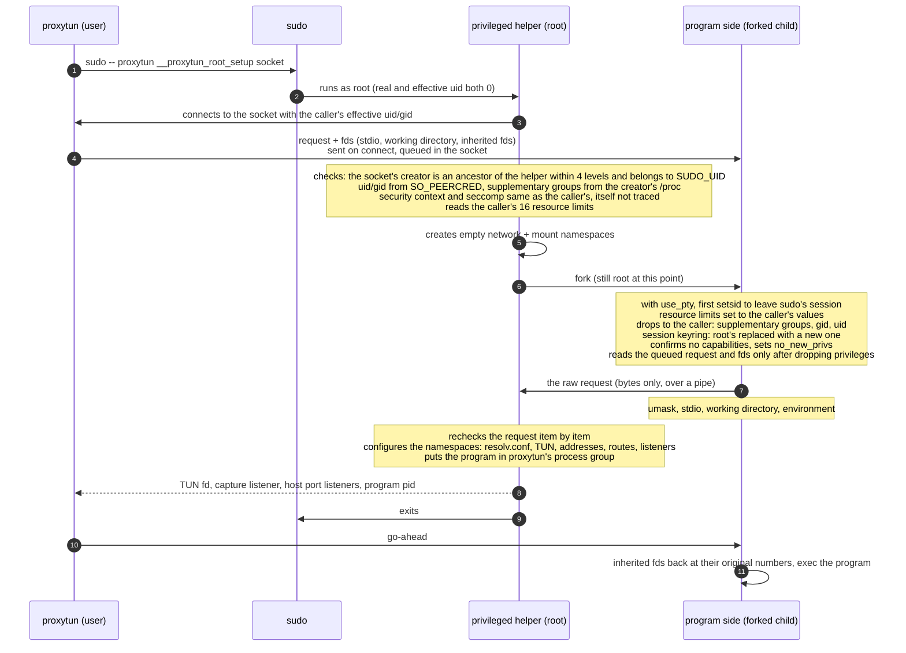

# proxytun architecture · 5 Run modes and the sudo helper

[简体中文](privilege.md) · **English**

> [Index](../ARCHITECTURE_en.md) · [0 Primer](primer_en.md) · [1–2 Overview](overview_en.md) · [3.0–3.2 Core flows](flow_en.md) · [3.3–3.6 Flow details](flow-details_en.md) · [4 Modules](modules_en.md) · **5 Run modes and the sudo helper** · [6 Processes, signals and lifecycle](lifecycle_en.md) · [7–8 Load balancing and operations](operations_en.md)

## 5. Run modes and the sudo helper

### 5.1 Three modes

| Mode | When | Who builds the namespace | The program's identity |
|---|---|---|---|
| userns | Unprivileged user namespaces are available (most recent distributions, WSL2) | The setup process, with no privileges at all | The original user (uid/gid mapped to itself), no capabilities after exec |
| sudo | They are not (CentOS 7 by default, `max_user_namespaces=0`, AppArmor taking the capabilities away) | The privileged helper started by sudo | The original user (with supplementary groups), capabilities cleared, `no_new_privs` |
| root | Run after logging in as root (or `su -`) | The setup process (no user namespace) | root, full capabilities |



- **`sudo proxytun` is refused.** Except for the privileged helper, every proxytun entry point (including the internal `__proxytun_setup`) running with euid 0
  refuses whenever the real uid is not 0 (a setuid install) or the environment has `SUDO_UID` / `SUDO_USER` / `SUDO_COMMAND` / `DOAS_USER` / `PKEXEC_UID`. Otherwise a
  sudoers rule that allows only proxytun would allow any root command (`sudo proxytun -- sh`). Other ways to gain root (ksu, userhelper, `systemd-run --uid=0`) leave no recognizable trace,
  so only sudo may be used to authorize proxytun.
- **Fallback condition.** Only a problem with the user namespace itself (it cannot be created, or an LSM takes away the capabilities inside it, seen as EPERM / EACCES) falls back to sudo.

### 5.2 The sudo-mode flow

proxytun creates a unix socket in a private 0700 directory and runs `sudo -- <proxytun's own absolute path> __proxytun_root_setup <socket path>`
(sudo closes fds ≥ 3, so only a path can be passed). The `sudo` used is the first one on PATH that is owned by root and has the setuid bit, i.e. sudo itself;
wrapper scripts ahead of it (such as devtoolset's `scl enable` wrapper) are skipped: such a wrapper rewrites the command line (taking `--` as the command)
and also carries the user's environment to root with `-E`. The privileged helper (root) builds the namespace as shown below, then exits immediately.



Key points (for the design rationale see [DESIGN.md section 3](../DESIGN_en.md#3-privilege-model)):

- **No root process ever receives the user's fds.** Closing an fd the user supplied can block forever (a socket with linger set that cannot send, a file on the user's FUSE mount),
  and the root helper and the sudo waiting for it would then hang. So the request and fds are received by the program side, which has already dropped to the user, and it passes the raw request to the helper over a pipe; the helper never closes the control socket itself
  but leaves it for the kernel to close on exit. When the helper fails it SIGKILLs the program side but does not wait for it.
- **Identity comes only from the kernel.** The program's uid and gid come from the socket's `SO_PEERCRED`, its supplementary groups from the creator's `/proc/<pid>/status`; nothing the request claims about itself is trusted.
  The socket's creator must be an ancestor process of the helper (still alive, its pid not reused), otherwise the helper disconnects at once without sending any message; it must also belong to `SUDO_UID` and not be root, otherwise the helper replies with one error and exits.
- **The request is rechecked item by item**: fake IP range /8–/22; the process group must be the caller's own; forwarded addresses must be loopback, ports neither 0 nor 53, no duplicates, at most 250;
  umask at most 0777; at most 249 inherited fds, numbers at least 3 and below 2^20, no duplicates.
- **Timeouts.** If the client says nothing for 10 seconds, the helper exits; waiting for the program side's report adds at most 5 more seconds (by then it is the user's process, and the user can stop it);
  waiting for it to leave sudo's session takes at most 10 seconds. proxytun's side waits at most 60 seconds for the namespace to be ready.
- **The program's process attributes match userns mode**: the caller's resource limits (not the different limits PAM / sudo give root), umask, working directory, environment variables,
  inherited fds (at their original numbers), a SIGPIPE the caller ignores. Session keyring: the inherited one is kept when it belongs to the caller (as in userns mode);
  when it belongs to root (pam_keyinit, the RHEL default) or is no longer valid, it is replaced with a new keyring of the user's own.
- **When it refuses to run**: sudoers sets `ROLE` / `TYPE` (security context differs from the caller's); `intercept` / `log_subcmds` is enabled (the helper is traced or has an extra seccomp filter);
  keyctl is filtered, so it cannot tell whose session keyring the program would get (Docker's default seccomp).
- **use_pty.** sudo puts the command in a pty session of its own; when the helper exits, the session leader (sudo's monitor process) exits with it, and the kernel sends SIGHUP to that terminal's foreground process group.
  So the program side first leaves with `setsid()`, and the helper reports back only after being told so over the pipe. From then on the program has no controlling terminal; proxytun forwards the terminal's Ctrl+C to its whole process group (section 6).

### 5.3 Installation requirements

What sudo runs as root is proxytun's own executable, so it must live where only root can write (an ordinary user who can modify it can run arbitrary code as root). The passwordless sudoers rule allows only the privileged helper:

```
alice ALL=(root) NOPASSWD: /usr/local/bin/proxytun __proxytun_root_setup *
```

The helper refuses extra arguments. The helper runs only when the real and effective uid are both 0 (as sudo does it); when started setuid, the real uid is the caller's,
and `SUDO_UID` is also set by the caller, so it refuses outright.
